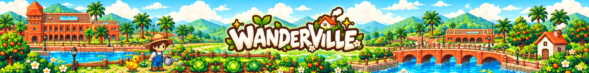
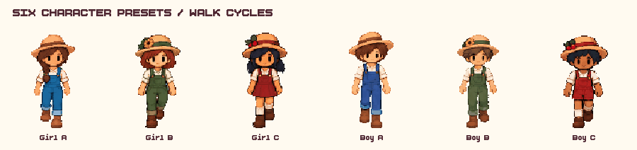
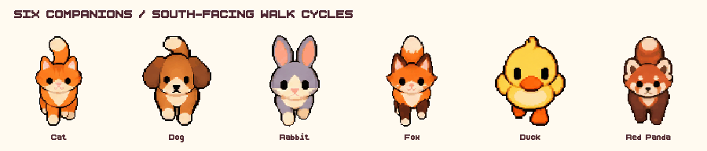
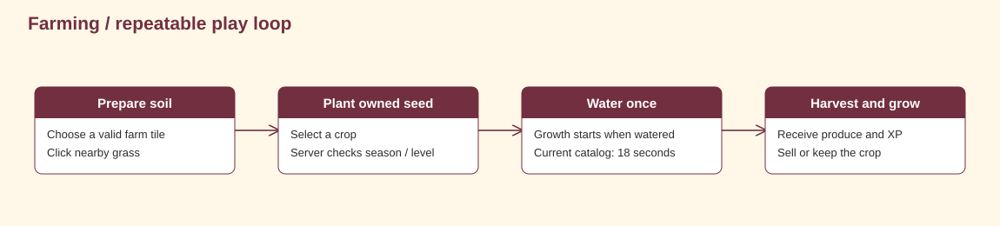
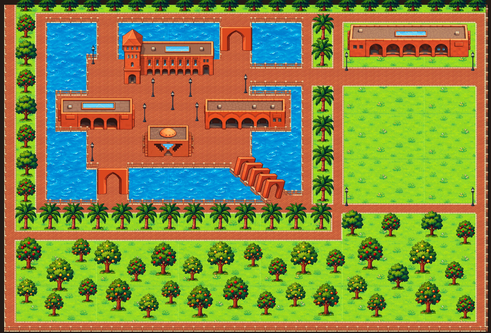

  

  

# Wanderville

**Grow a little. Explore the campus. Make the place your own.**

A Godot campus life and farming game: grow crops, build and furnish a home, catch fish, run a shop, choose a companion and spend time with friends. A red-brick campus, canals, seasonal scenery and music connect its different spaces. FastAPI and PostgreSQL support persistent accounts and game state.

Banner artwork generated using our actual campus map, buildings, logo and character assets as references.

[Start playing](docs/MANUAL.md) · [Run locally](docs/BUILD_AND_DEPLOY.md) · [Understand the system](docs/SYSTEM_DESIGN.md)

## In this checkout

| Area | What is connected |
| --- | --- |
| Farming and trees | Click to till, plant, water and harvest; carry tiles with E and chop seasonal trees with C |
| Homes and interiors | Six house designs, staged construction, five floor finishes, entering/exiting and local layout saves |
| Furniture | 228 catalog entries across 11 categories; place, rotate, resize and rearrange |
| Fishing minigame | Track a moving fish, fill the catch meter and catch one of ten species before the timer ends |
| Progression | Aura, XP, level unlocks and shared inventory capacity |
| Inventory and Store | Clickable storage shelves, a swimming aquarium display, buy/sell, starter seeds and transaction receipts |
| Marketplace | A separate shopping street, General Store, 12 storefront choices, player-stocked shelves and sales history |
| Companions | Cat, dog, rabbit, fox, duck or red panda; following, wandering, resting and sleeping |
| Appearance and profile | Six character presets, Wardrobe, animated directional previews, Mirror and profile controls |
| Social spaces | Social Lobby, Reception, friends, messages, requests, invitations and notices |
| Nearby and community | Proximity text/voice, gifts, wishlists, privacy and farm visiting |
| Music and atmosphere | Title/world/marketplace/fishing music, gameplay sound effects, separate audio controls, seasons and day/night visuals |
| Multiplayer | Default WebSocket path; optional experimental ENet campus movement |

These descriptions come from source review at `31ca97c39c05`. See the [manual](docs/MANUAL.md) for how to play and [mechanics](docs/GAME_MECHANICS.md) for exact rules and current integration boundaries, including local housing resources. Runtime evidence is tracked in [testing](docs/TESTING.md).

<strong>See our characters and companions in motion</strong>

Source sprite previews. [Full animation gallery](docs/WORLD_ART_BIBLE.md#animation-gallery).

## A first harvest

Claim 5 Paddy Seeds and 5 Wheat Seeds once, plant a seed in your farm, water it, and harvest when ready. The current server uses 18 seconds of watered growth for catalog crops. The [manual](docs/MANUAL.md) explains the controls; [mechanics](docs/GAME_MECHANICS.md) gives the numbers.

## The world

Our current campus: red-brick halls, canals, the arched bridge, palms and orchard. Captured from the actual Map scene used by `world.tscn`, in Godot 4.6.2 with a fixed daylight preview.

## Documentation

| Play and design | Engineering | Project |
| --- | --- | --- |
| [Player manual](docs/MANUAL.md) | [System design](docs/SYSTEM_DESIGN.md) | [Testing and evidence](docs/TESTING.md) |
| [Game design](docs/GAME_DESIGN.md) | [Godot client](docs/CLIENT_SIDE.md) | [Build and deploy](docs/BUILD_AND_DEPLOY.md) |
| [Game mechanics](docs/GAME_MECHANICS.md) | [Database and ERDs](docs/DATABASE.md) | [Creators note](docs/CREATORS_NOTE.md) |
| [World and art](docs/WORLD_ART_BIBLE.md) | [HTTP API](docs/API.md) | [Future scope](docs/FUTURE_SCOPE.md) |
| | [Networking](docs/NETWORKING.md) | |

## Meet the team

| Zenia | Anika | Tayma |
| :---: | :---: | :---: |
|  |  |  |
| [@zenken24](https://github.com/zenken24) | [@SafiaAmanAnika](https://github.com/SafiaAmanAnika) | [@tayma-06](https://github.com/tayma-06) |

## Development

Godot **4.6** · Python **3.12.12** · FastAPI · SQLAlchemy · PostgreSQL.

Use the [local setup steps](docs/BUILD_AND_DEPLOY.md) before running the Windows launchers. The deployment blueprint is checked in; its presence does not establish that a public server is live.

The banner is generated promotional artwork; the campus image above is a real Godot scene capture. See the [credits and project story](docs/CREATORS_NOTE.md).

[Player handbook](docs/MANUAL.md) · [Game design](docs/GAME_DESIGN.md) · [Meet the team](#meet-the-team)
