# Database

Current tables, real foreign keys, constraints and migration boundaries.

<strong>Explore this page</strong>

[Home](../README.md) · [Reading the schema](#reading-the-schema) · [Domain diagrams](#domain-diagrams) · [Tables and constraints](#tables-and-constraints) · [Migrations and transactions](#migrations-and-transactions) · [Backup and restore](#backup-and-restore)

## Reading the schema

The current SQLAlchemy model registry defines **56 tables**. This is ORM metadata, not proof that a deployed database has applied all migrations. The expandable tables below contain the columns, foreign keys, unique keys and indexes. Services enforce additional gameplay rules.

Persistent tables cover much more than crops: fishing sessions and drops, house tiers and decoration records, pet selection, player shops/listings/sales, profiles, friendship, messages, gifts, visits, goals, events and trees. Some visible game systems keep different local state: the playable six-house layout/furniture editor saves device files, audio settings use `settings.cfg`, and companion motion and fishing target positions are transient client simulation. A backend house/decorations row is therefore not a complete serialization of the room the player arranged. See [gameplay ownership](SYSTEM_DESIGN.md#gameplay-ownership).

The supplied reference mixes client classes, services and database entities. The new ER diagrams contain database tables only. Arrows go from an FK column to its referenced table; these diagrams intentionally do not invent UML composition relationships. Nullability and uniqueness in the tables below define optionality and one-to-one constraints.

## Domain diagrams

<strong>Expand farm schema</strong>

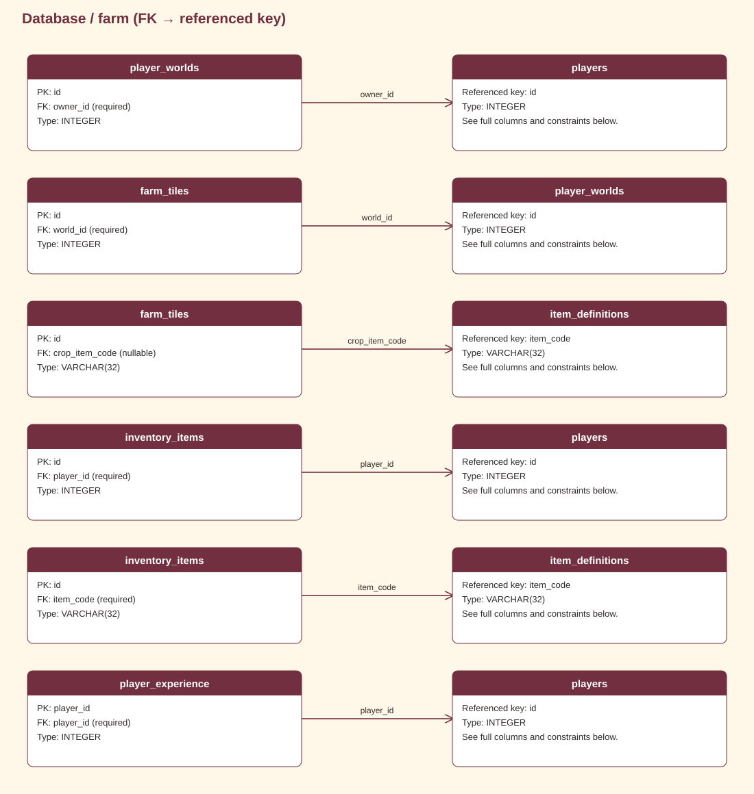

[Edit in draw.io](assets/diagrams/erd-farm.drawio)

<strong>Expand identity schema</strong>

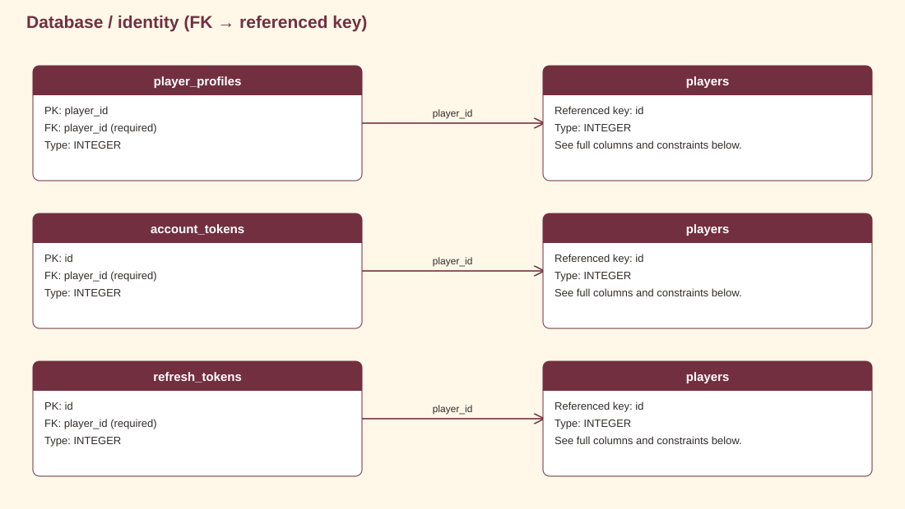

[Edit in draw.io](assets/diagrams/erd-identity.drawio)

<strong>Expand economy schema</strong>

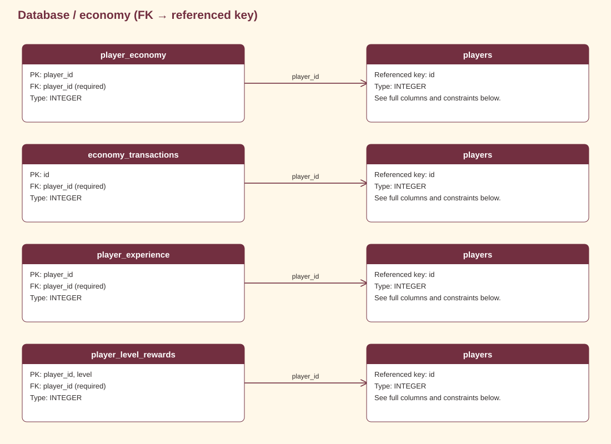

[Edit in draw.io](assets/diagrams/erd-economy.drawio)

<strong>Expand social schema</strong>

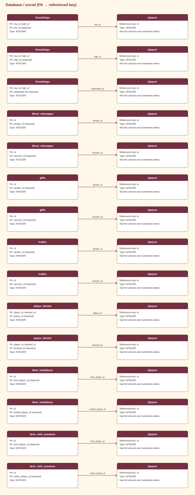

[Edit in draw.io](assets/diagrams/erd-social.drawio)

<strong>Expand housing schema</strong>

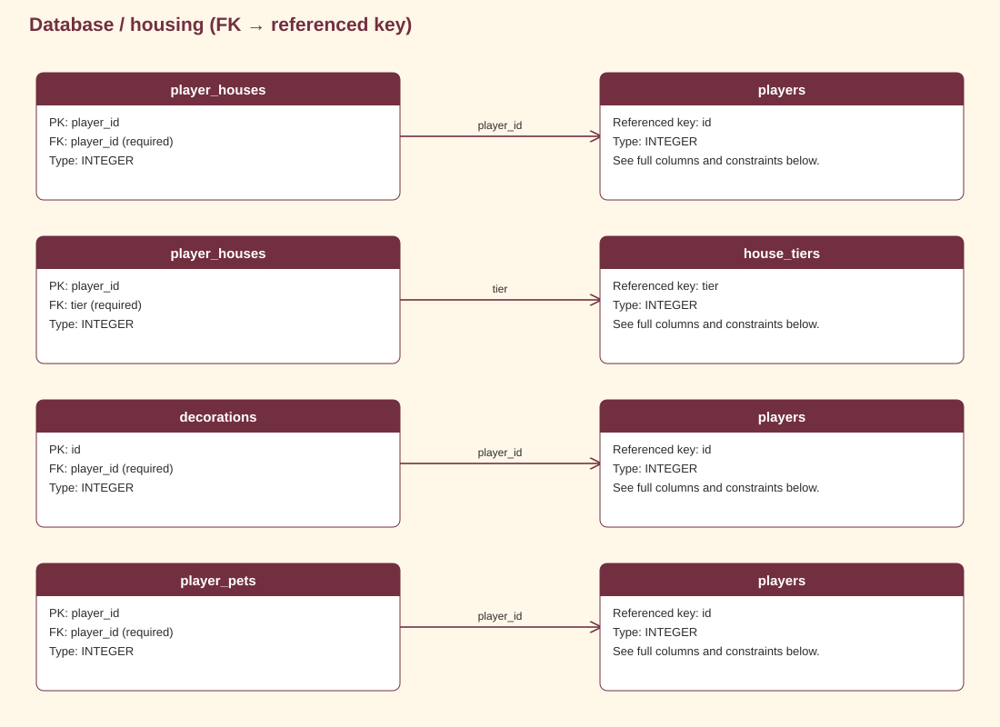

[Edit in draw.io](assets/diagrams/erd-housing.drawio)

<strong>Expand market schema</strong>

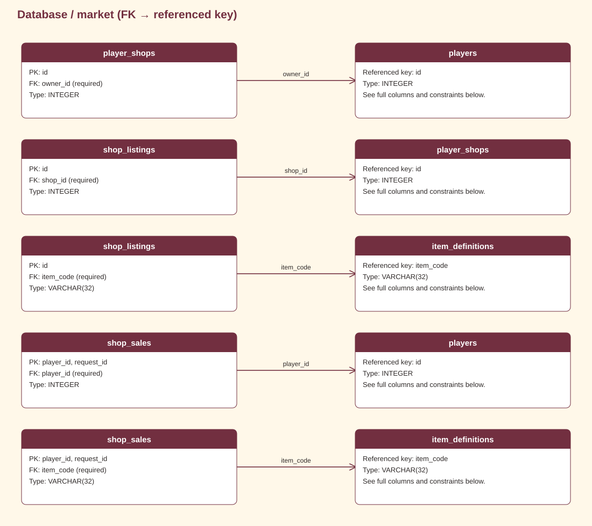

[Edit in draw.io](assets/diagrams/erd-market.drawio)

<strong>Expand realtime schema</strong>

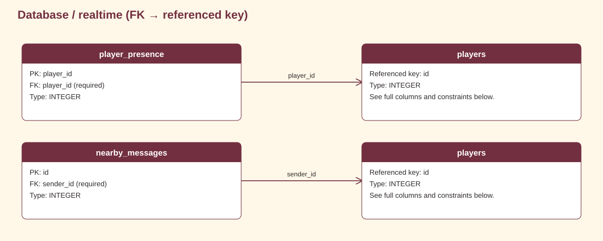

[Edit in draw.io](assets/diagrams/erd-realtime.drawio)

<strong>Expand progression schema</strong>

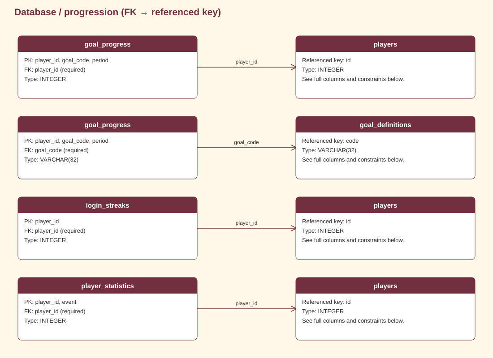

[Edit in draw.io](assets/diagrams/erd-progression.drawio)

<strong>Expand shop schema</strong>

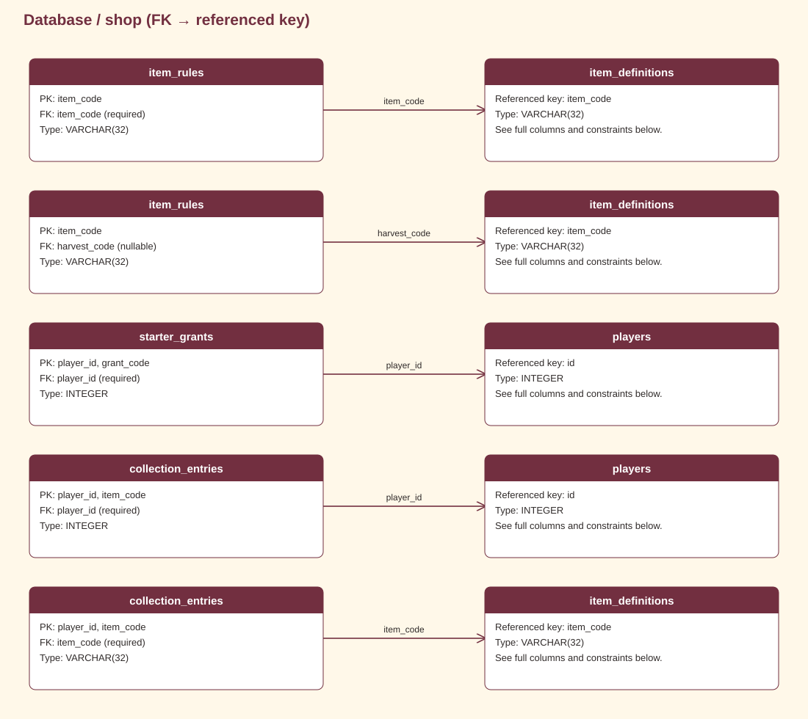

[Edit in draw.io](assets/diagrams/erd-shop.drawio)

<strong>Expand world schema</strong>

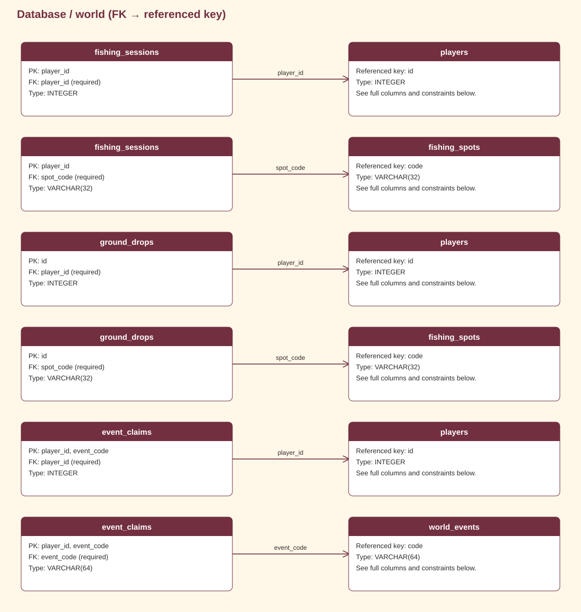

[Edit in draw.io](assets/diagrams/erd-world.drawio)

<strong>Expand support schema</strong>

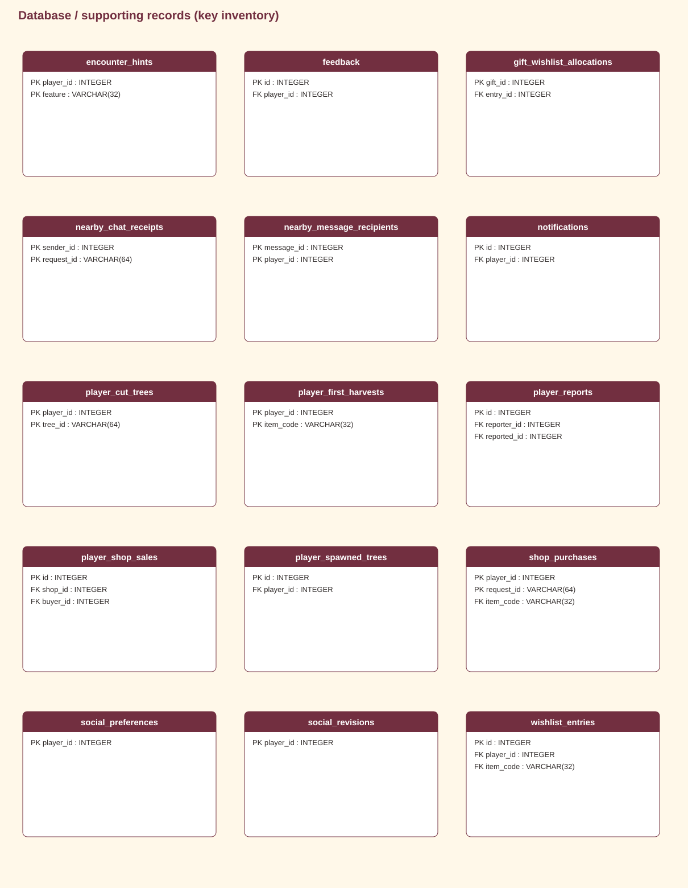

[Edit in draw.io](assets/diagrams/erd-support.drawio)

## Tables and constraints

<strong>account_tokens</strong>

| Column | Type | Nullable | Key / reference |
| --- | --- | --- | --- |
| `id` | `INTEGER` | no | PK  |
| `player_id` | `INTEGER` | no | players.id |
| `token_hash` | `VARCHAR(64)` | no |  |
| `token_type` | `VARCHAR(32)` | no |  |
| `expires_at` | `DATETIME` | no |  |
| `used_at` | `DATETIME` | yes |  |
| `created_at` | `DATETIME` | no |  |

Unique: `token_hash`.

Indexes: `ix_account_tokens_player_id` (player_id).

Checks:

- `token_type IN ('email_verification', 'password_reset')`

<strong>collection_entries</strong>

| Column | Type | Nullable | Key / reference |
| --- | --- | --- | --- |
| `player_id` | `INTEGER` | no | PK players.id |
| `item_code` | `VARCHAR(32)` | no | PK item_definitions.item_code |
| `first_obtained_at` | `DATETIME` | no |  |

<strong>decorations</strong>

| Column | Type | Nullable | Key / reference |
| --- | --- | --- | --- |
| `id` | `INTEGER` | no | PK  |
| `player_id` | `INTEGER` | no | players.id |
| `item_code` | `VARCHAR(32)` | no | item_definitions.item_code |
| `x` | `INTEGER` | no |  |
| `y` | `INTEGER` | no |  |

Unique: `player_id, x, y`.

Indexes: `ix_decorations_player_id` (player_id).

Checks:

- `x BETWEEN 0 AND 32767 AND y BETWEEN 0 AND 32767`

<strong>direct_messages</strong>

| Column | Type | Nullable | Key / reference |
| --- | --- | --- | --- |
| `id` | `INTEGER` | no | PK  |
| `sender_id` | `INTEGER` | no | players.id |
| `receiver_id` | `INTEGER` | no | players.id |
| `body` | `VARCHAR(500)` | no |  |
| `created_at` | `DATETIME` | no |  |

Indexes: `ix_dm_inbox` (receiver_id, id); `ix_direct_messages_sender_id` (sender_id).

Checks:

- `sender_id <> receiver_id`

<strong>economy_transactions</strong>

| Column | Type | Nullable | Key / reference |
| --- | --- | --- | --- |
| `id` | `INTEGER` | no | PK  |
| `player_id` | `INTEGER` | no | players.id |
| `amount` | `BIGINT` | no |  |
| `transaction_type` | `VARCHAR(16)` | no |  |
| `reason` | `VARCHAR(255)` | no |  |
| `reference_type` | `VARCHAR(32)` | yes |  |
| `reference_id` | `VARCHAR(64)` | yes |  |
| `created_at` | `DATETIME` | no |  |

Indexes: `ix_economy_transactions_player_id` (player_id); `ix_economy_transactions_created_at` (created_at).

Checks:

- `(transaction_type = 'earn' AND amount > 0) OR (transaction_type = 'spend' AND amount < 0)`

<strong>encounter_hints</strong>

| Column | Type | Nullable | Key / reference |
| --- | --- | --- | --- |
| `player_id` | `INTEGER` | no | PK players.id |
| `feature` | `VARCHAR(32)` | no | PK  |

<strong>event_claims</strong>

| Column | Type | Nullable | Key / reference |
| --- | --- | --- | --- |
| `player_id` | `INTEGER` | no | PK players.id |
| `event_code` | `VARCHAR(64)` | no | PK world_events.code |

<strong>farm_invitations</strong>

| Column | Type | Nullable | Key / reference |
| --- | --- | --- | --- |
| `id` | `INTEGER` | no | PK  |
| `host_player_id` | `INTEGER` | no | players.id |
| `invited_player_id` | `INTEGER` | no | players.id |
| `world_id` | `INTEGER` | no | player_worlds.id |
| `status` | `VARCHAR(16)` | no |  |
| `active_key` | `VARCHAR(64)` | yes |  |
| `created_at` | `DATETIME` | no |  |
| `expires_at` | `DATETIME` | no |  |
| `responded_at` | `DATETIME` | yes |  |

Unique: `active_key`.

Indexes: `ix_farm_invitations_expiry` (expires_at); `ix_farm_invitations_guest_status` (invited_player_id, status, id); `ix_farm_invitations_host_status` (host_player_id, status).

Checks:

- `expires_at > created_at`
- `host_player_id <> invited_player_id`
- `status IN ('PENDING','ACCEPTED','DECLINED','EXPIRED','CANCELLED')`

<strong>farm_tiles</strong>

| Column | Type | Nullable | Key / reference |
| --- | --- | --- | --- |
| `id` | `INTEGER` | no | PK  |
| `world_id` | `INTEGER` | no | player_worlds.id |
| `x` | `INTEGER` | no |  |
| `y` | `INTEGER` | no |  |
| `is_tilled` | `BOOLEAN` | no |  |
| `crop_item_code` | `VARCHAR(32)` | yes | item_definitions.item_code |
| `planted_at` | `DATETIME` | yes |  |
| `growth_progress_seconds` | `FLOAT` | no |  |
| `growth_stage` | `INTEGER` | no |  |
| `last_growth_update_at` | `DATETIME` | yes |  |
| `is_watered` | `BOOLEAN` | no |  |
| `watered_at` | `DATETIME` | yes |  |
| `created_at` | `DATETIME` | no |  |
| `updated_at` | `DATETIME` | no |  |

Unique: `world_id, x, y`.

Indexes: `ix_farm_tiles_crop_item_code` (crop_item_code); `ix_farm_tiles_world_id` (world_id).

Checks:

- `(crop_item_code IS NOT NULL AND is_tilled AND planted_at IS NOT NULL AND last_growth_update_at IS NOT NULL) OR (crop_item_code IS NULL AND planted_at IS NULL AND growth_progress_seconds = 0 AND growth_stage = 0 AND NOT is_watered AND watered_at IS NULL AND last_growth_update_at IS NULL)`
- `NOT is_watered OR watered_at IS NOT NULL`
- `growth_progress_seconds >= 0`
- `growth_stage BETWEEN 0 AND 3`
- `x >= 0 AND y >= 0`

<strong>farm_visit_sessions</strong>

| Column | Type | Nullable | Key / reference |
| --- | --- | --- | --- |
| `id` | `INTEGER` | no | PK  |
| `world_id` | `INTEGER` | no | player_worlds.id |
| `host_player_id` | `INTEGER` | no | players.id |
| `visitor_player_id` | `INTEGER` | no | players.id |
| `status` | `VARCHAR(16)` | no |  |
| `active_visitor_key` | `INTEGER` | yes |  |
| `started_at` | `DATETIME` | no |  |
| `last_seen_at` | `DATETIME` | no |  |
| `ended_at` | `DATETIME` | yes |  |

Unique: `active_visitor_key`.

Indexes: `ix_farm_visit_sessions_visitor` (visitor_player_id, status); `ix_farm_visit_sessions_heartbeat` (status, last_seen_at); `ix_farm_visit_sessions_world_status` (world_id, status).

Checks:

- `ended_at IS NULL OR ended_at >= started_at`
- `host_player_id <> visitor_player_id`
- `status IN ('ACTIVE','LEFT','DISCONNECTED','KICKED','EXPIRED')`

<strong>feedback</strong>

| Column | Type | Nullable | Key / reference |
| --- | --- | --- | --- |
| `id` | `INTEGER` | no | PK  |
| `player_id` | `INTEGER` | no | players.id |
| `message` | `VARCHAR(2000)` | no |  |
| `created_at` | `DATETIME` | no |  |

Indexes: `ix_feedback_player_id` (player_id).

<strong>fishing_sessions</strong>

| Column | Type | Nullable | Key / reference |
| --- | --- | --- | --- |
| `player_id` | `INTEGER` | no | PK players.id |
| `cast_id` | `VARCHAR(64)` | no |  |
| `spot_code` | `VARCHAR(32)` | no | fishing_spots.code |
| `rod_code` | `VARCHAR(32)` | no | item_definitions.item_code |
| `item_code` | `VARCHAR(32)` | no | item_definitions.item_code |
| `bite_at` | `DATETIME` | no |  |
| `expires_at` | `DATETIME` | no |  |
| `resolved` | `BOOLEAN` | no |  |

Unique: `cast_id`.

Checks:

- `expires_at > bite_at`

<strong>fishing_spots</strong>

| Column | Type | Nullable | Key / reference |
| --- | --- | --- | --- |
| `code` | `VARCHAR(32)` | no | PK  |
| `name` | `VARCHAR(64)` | no |  |
| `freezes_in_winter` | `BOOLEAN` | no |  |

<strong>friendships</strong>

| Column | Type | Nullable | Key / reference |
| --- | --- | --- | --- |
| `low_id` | `INTEGER` | no | PK players.id |
| `high_id` | `INTEGER` | no | PK players.id |
| `requested_by` | `INTEGER` | no | players.id |
| `status` | `VARCHAR(16)` | no |  |

Indexes: `ix_friend_high_status` (high_id, status).

Checks:

- `low_id < high_id`
- `requested_by = low_id OR requested_by = high_id`
- `status IN ('pending','accepted')`

<strong>gift_wishlist_allocations</strong>

| Column | Type | Nullable | Key / reference |
| --- | --- | --- | --- |
| `gift_id` | `INTEGER` | no | PK gifts.id |
| `entry_id` | `INTEGER` | no | wishlist_entries.id |
| `expected_version` | `INTEGER` | no |  |

Indexes: `ix_gift_wishlist_allocations_entry_id` (entry_id).

<strong>gifts</strong>

| Column | Type | Nullable | Key / reference |
| --- | --- | --- | --- |
| `id` | `INTEGER` | no | PK  |
| `sender_id` | `INTEGER` | no | players.id |
| `receiver_id` | `INTEGER` | no | players.id |
| `request_id` | `VARCHAR(64)` | no |  |
| `item_code` | `VARCHAR(32)` | no | item_definitions.item_code |
| `quantity` | `INTEGER` | no |  |
| `claimed` | `BOOLEAN` | no |  |
| `created_at` | `DATETIME` | no |  |

Unique: `sender_id, request_id`.

Indexes: `ix_gift_mailbox` (receiver_id, claimed, id).

Checks:

- `sender_id <> receiver_id AND quantity > 0`

<strong>goal_definitions</strong>

| Column | Type | Nullable | Key / reference |
| --- | --- | --- | --- |
| `code` | `VARCHAR(32)` | no | PK  |
| `kind` | `VARCHAR(16)` | no |  |
| `title` | `VARCHAR(128)` | no |  |
| `event` | `VARCHAR(32)` | no |  |
| `target` | `INTEGER` | no |  |
| `aura_reward` | `INTEGER` | no |  |

Indexes: `ix_goal_definitions_event` (event).

Checks:

- `kind IN ('achievement','daily')`
- `target > 0 AND aura_reward >= 0`

<strong>goal_progress</strong>

| Column | Type | Nullable | Key / reference |
| --- | --- | --- | --- |
| `player_id` | `INTEGER` | no | PK players.id |
| `goal_code` | `VARCHAR(32)` | no | PK goal_definitions.code |
| `period` | `INTEGER` | no | PK  |
| `progress` | `INTEGER` | no |  |
| `rewarded` | `BOOLEAN` | no |  |

Checks:

- `progress >= 0`

<strong>ground_drops</strong>

| Column | Type | Nullable | Key / reference |
| --- | --- | --- | --- |
| `id` | `INTEGER` | no | PK  |
| `player_id` | `INTEGER` | no | players.id |
| `item_code` | `VARCHAR(32)` | no | item_definitions.item_code |
| `spot_code` | `VARCHAR(32)` | no | fishing_spots.code |
| `expires_at` | `DATETIME` | no |  |
| `claimed` | `BOOLEAN` | no |  |

Indexes: `ix_ground_owner_expiry` (player_id, expires_at).

<strong>house_tiers</strong>

| Column | Type | Nullable | Key / reference |
| --- | --- | --- | --- |
| `tier` | `INTEGER` | no | PK  |
| `name` | `VARCHAR(64)` | no |  |
| `cost` | `INTEGER` | no |  |
| `required_level` | `INTEGER` | no |  |

Checks:

- `tier >= 1 AND cost >= 0 AND required_level >= 1`

<strong>inventory_items</strong>

| Column | Type | Nullable | Key / reference |
| --- | --- | --- | --- |
| `id` | `INTEGER` | no | PK  |
| `player_id` | `INTEGER` | no | players.id |
| `item_code` | `VARCHAR(32)` | no | item_definitions.item_code |
| `quantity` | `INTEGER` | no |  |
| `stack_no` | `INTEGER` | no |  |
| `slot_index` | `INTEGER` | yes |  |
| `location` | `VARCHAR(16)` | no |  |
| `created_at` | `DATETIME` | no |  |
| `updated_at` | `DATETIME` | no |  |

Unique: `player_id, item_code, location, stack_no`.

Indexes: `ix_inventory_items_player_id` (player_id); `ix_inventory_player_location` (player_id, location); `ix_inventory_items_item_code` (item_code).

Checks:

- `location = 'inventory'`
- `quantity > 0`
- `slot_index IS NULL OR slot_index >= 0`
- `stack_no >= 0`

<strong>item_definitions</strong>

| Column | Type | Nullable | Key / reference |
| --- | --- | --- | --- |
| `id` | `INTEGER` | no | PK  |
| `item_code` | `VARCHAR(32)` | no |  |
| `name` | `VARCHAR(64)` | no |  |
| `category` | `VARCHAR(32)` | no |  |
| `max_stack` | `INTEGER` | no |  |
| `sell_value` | `INTEGER` | no |  |
| `buy_value` | `INTEGER` | yes |  |
| `growth_time_seconds` | `INTEGER` | yes |  |
| `season` | `VARCHAR(16)` | no |  |
| `xp_reward` | `INTEGER` | no |  |
| `harvest_category` | `VARCHAR(16)` | yes |  |
| `harvest_xp` | `INTEGER` | no |  |
| `rarity` | `VARCHAR(16)` | no |  |
| `tradable` | `BOOLEAN` | no |  |
| `giftable` | `BOOLEAN` | no |  |
| `usable` | `BOOLEAN` | no |  |
| `placeable` | `BOOLEAN` | no |  |
| `icon_path` | `VARCHAR(255)` | yes |  |
| `description` | `VARCHAR(512)` | yes |  |

Unique: `item_code`.

Indexes: `ix_item_definitions_season` (season); `ix_item_definitions_category` (category).

Checks:

- `buy_value IS NULL OR buy_value >= 0`
- `growth_time_seconds IS NULL OR growth_time_seconds > 0`
- `harvest_xp >= 0`
- `max_stack > 0`
- `season IN ('all', 'spring', 'summer', 'autumn', 'winter')`
- `sell_value >= 0`
- `xp_reward >= 0`

<strong>item_rules</strong>

| Column | Type | Nullable | Key / reference |
| --- | --- | --- | --- |
| `item_code` | `VARCHAR(32)` | no | PK item_definitions.item_code |
| `partition` | `VARCHAR(32)` | no |  |
| `required_level` | `INTEGER` | no |  |
| `harvest_code` | `VARCHAR(32)` | yes | item_definitions.item_code |
| `pet_food` | `BOOLEAN` | no |  |
| `pet_accessory` | `BOOLEAN` | no |  |
| `fishing_rod` | `BOOLEAN` | no |  |

Checks:

- `partition IN ('seeds','crops','fish','rare_materials','tools','houses')`
- `required_level >= 1`

<strong>login_streaks</strong>

| Column | Type | Nullable | Key / reference |
| --- | --- | --- | --- |
| `player_id` | `INTEGER` | no | PK players.id |
| `last_date` | `DATE` | yes |  |
| `streak` | `INTEGER` | no |  |

Checks:

- `streak >= 0`

<strong>nearby_chat_receipts</strong>

| Column | Type | Nullable | Key / reference |
| --- | --- | --- | --- |
| `sender_id` | `INTEGER` | no | PK players.id |
| `request_id` | `VARCHAR(64)` | no | PK  |
| `body_hash` | `VARCHAR(64)` | no |  |
| `message_id` | `INTEGER` | no |  |
| `expires_at` | `DATETIME` | no |  |

Indexes: `ix_nearby_chat_receipts_expires_at` (expires_at).

<strong>nearby_message_recipients</strong>

| Column | Type | Nullable | Key / reference |
| --- | --- | --- | --- |
| `room_epoch` | `INTEGER` | no |  |
| `message_id` | `INTEGER` | no | PK nearby_messages.id |
| `player_id` | `INTEGER` | no | PK players.id |

Indexes: `ix_nearby_message_recipients_player_id` (player_id).

<strong>nearby_messages</strong>

| Column | Type | Nullable | Key / reference |
| --- | --- | --- | --- |
| `id` | `INTEGER` | no | PK  |
| `sender_id` | `INTEGER` | no | players.id |
| `room` | `VARCHAR(64)` | no |  |
| `sender_epoch` | `INTEGER` | no |  |
| `created_at` | `DATETIME` | yes |  |
| `body` | `VARCHAR(500)` | no |  |
| `expires_at` | `DATETIME` | no |  |

Indexes: `ix_nearby_expiry` (expires_at).

<strong>notifications</strong>

| Column | Type | Nullable | Key / reference |
| --- | --- | --- | --- |
| `id` | `INTEGER` | no | PK  |
| `player_id` | `INTEGER` | no | players.id |
| `kind` | `VARCHAR(32)` | no |  |
| `message` | `VARCHAR(512)` | no |  |
| `target` | `VARCHAR(128)` | yes |  |
| `event_key` | `VARCHAR(128)` | yes |  |
| `is_read` | `BOOLEAN` | no |  |
| `dismissed` | `BOOLEAN` | no |  |
| `created_at` | `DATETIME` | no |  |

Unique: `player_id, event_key`.

Indexes: `ix_notification_inbox` (player_id, dismissed, id).

<strong>player_blocks</strong>

| Column | Type | Nullable | Key / reference |
| --- | --- | --- | --- |
| `player_id` | `INTEGER` | no | PK players.id |
| `blocked_id` | `INTEGER` | no | PK players.id |

Indexes: `ix_block_reverse` (blocked_id, player_id).

Checks:

- `player_id <> blocked_id`

<strong>player_cut_trees</strong>

| Column | Type | Nullable | Key / reference |
| --- | --- | --- | --- |
| `player_id` | `INTEGER` | no | PK players.id |
| `tree_id` | `VARCHAR(64)` | no | PK  |
| `cut_at` | `DATETIME` | no |  |

<strong>player_economy</strong>

| Column | Type | Nullable | Key / reference |
| --- | --- | --- | --- |
| `player_id` | `INTEGER` | no | PK players.id |
| `aura_balance` | `BIGINT` | no |  |
| `total_earned` | `BIGINT` | no |  |
| `total_spent` | `BIGINT` | no |  |
| `updated_at` | `DATETIME` | no |  |

Checks:

- `aura_balance >= 0`
- `total_earned >= 0`
- `total_spent >= 0`

<strong>player_experience</strong>

| Column | Type | Nullable | Key / reference |
| --- | --- | --- | --- |
| `player_id` | `INTEGER` | no | PK players.id |
| `total_xp` | `BIGINT` | no |  |
| `level` | `INTEGER` | no |  |
| `inventory_base_capacity` | `INTEGER` | no |  |
| `updated_at` | `DATETIME` | no |  |

Checks:

- `inventory_base_capacity >= 0`
- `level >= 1`
- `total_xp >= 0`

<strong>player_first_harvests</strong>

| Column | Type | Nullable | Key / reference |
| --- | --- | --- | --- |
| `player_id` | `INTEGER` | no | PK players.id |
| `item_code` | `VARCHAR(32)` | no | PK item_definitions.item_code |
| `harvested_at` | `DATETIME` | no |  |

<strong>player_houses</strong>

| Column | Type | Nullable | Key / reference |
| --- | --- | --- | --- |
| `player_id` | `INTEGER` | no | PK players.id |
| `tier` | `INTEGER` | no | house_tiers.tier |

<strong>player_level_rewards</strong>

| Column | Type | Nullable | Key / reference |
| --- | --- | --- | --- |
| `player_id` | `INTEGER` | no | PK players.id |
| `level` | `INTEGER` | no | PK  |
| `aura` | `INTEGER` | no |  |
| `granted_at` | `DATETIME` | no |  |

Checks:

- `aura >= 0`
- `level >= 1`

<strong>player_pets</strong>

| Column | Type | Nullable | Key / reference |
| --- | --- | --- | --- |
| `player_id` | `INTEGER` | no | PK players.id |
| `species` | `VARCHAR(32)` | no |  |
| `name` | `VARCHAR(32)` | no |  |
| `affection` | `INTEGER` | no |  |
| `accessory_code` | `VARCHAR(32)` | yes | item_definitions.item_code |
| `last_interaction_at` | `DATETIME` | yes |  |
| `fetch_started_at` | `DATETIME` | yes |  |

Checks:

- `affection BETWEEN 0 AND 100`

<strong>player_presence</strong>

| Column | Type | Nullable | Key / reference |
| --- | --- | --- | --- |
| `player_id` | `INTEGER` | no | PK players.id |
| `room` | `VARCHAR(64)` | no |  |
| `x` | `FLOAT` | no |  |
| `y` | `FLOAT` | no |  |
| `sequence` | `INTEGER` | no |  |
| `updated_at` | `DATETIME` | no |  |
| `room_epoch` | `INTEGER` | no |  |
| `emote` | `VARCHAR(16)` | yes |  |
| `emote_until` | `DATETIME` | yes |  |

Indexes: `ix_presence_room_time` (room, updated_at).

Checks:

- `sequence >= 0`

<strong>player_profiles</strong>

| Column | Type | Nullable | Key / reference |
| --- | --- | --- | --- |
| `player_id` | `INTEGER` | no | PK players.id |
| `character_code` | `VARCHAR(32)` | yes |  |
| `map_code` | `VARCHAR(32)` | no |  |
| `status_message` | `VARCHAR(140)` | no |  |
| `water_charges` | `INTEGER` | no |  |
| `music_volume` | `INTEGER` | no |  |
| `effects_volume` | `INTEGER` | no |  |
| `fullscreen` | `BOOLEAN` | no |  |
| `tutorial_step` | `INTEGER` | no |  |
| `last_seen_at` | `DATETIME` | yes |  |
| `last_saved_at` | `DATETIME` | yes |  |

Indexes: `ix_player_profiles_last_seen_at` (last_seen_at).

Checks:

- `music_volume BETWEEN 0 AND 100 AND effects_volume BETWEEN 0 AND 100`
- `tutorial_step BETWEEN 0 AND 3`
- `water_charges BETWEEN 0 AND 20`

<strong>player_reports</strong>

| Column | Type | Nullable | Key / reference |
| --- | --- | --- | --- |
| `id` | `INTEGER` | no | PK  |
| `reporter_id` | `INTEGER` | no | players.id |
| `reported_id` | `INTEGER` | no | players.id |
| `reason` | `VARCHAR(32)` | no |  |
| `details` | `VARCHAR(1000)` | no |  |
| `created_at` | `DATETIME` | no |  |

Indexes: `ix_player_reports_reporter_id` (reporter_id); `ix_player_reports_reported_id` (reported_id).

Checks:

- `reporter_id <> reported_id`

<strong>player_shop_sales</strong>

| Column | Type | Nullable | Key / reference |
| --- | --- | --- | --- |
| `id` | `INTEGER` | no | PK  |
| `shop_id` | `INTEGER` | no | player_shops.id |
| `buyer_id` | `INTEGER` | no | players.id |
| `item_code` | `VARCHAR(64)` | no |  |
| `quantity` | `INTEGER` | no |  |
| `price` | `INTEGER` | no |  |
| `sold_at` | `DATETIME` | no |  |

<strong>player_shops</strong>

| Column | Type | Nullable | Key / reference |
| --- | --- | --- | --- |
| `id` | `INTEGER` | no | PK  |
| `owner_id` | `INTEGER` | no | players.id |
| `option_id` | `VARCHAR(32)` | no |  |
| `side` | `VARCHAR(5)` | no |  |
| `name` | `VARCHAR(64)` | no |  |
| `created_at` | `DATETIME` | no |  |

Unique: `owner_id`.

Checks:

- `side IN ('left','right')`

<strong>player_spawned_trees</strong>

| Column | Type | Nullable | Key / reference |
| --- | --- | --- | --- |
| `id` | `INTEGER` | no | PK  |
| `player_id` | `INTEGER` | no | players.id |
| `season` | `VARCHAR(8)` | no |  |
| `scene` | `VARCHAR(128)` | no |  |
| `x` | `FLOAT` | no |  |
| `y` | `FLOAT` | no |  |
| `created_at` | `DATETIME` | no |  |

Indexes: `ix_player_spawned_trees_player_id` (player_id).

Checks:

- `season IN ('summer','autumn','winter','spring')`

<strong>player_statistics</strong>

| Column | Type | Nullable | Key / reference |
| --- | --- | --- | --- |
| `player_id` | `INTEGER` | no | PK players.id |
| `event` | `VARCHAR(32)` | no | PK  |
| `value` | `INTEGER` | no |  |

Checks:

- `value >= 0`

<strong>player_worlds</strong>

| Column | Type | Nullable | Key / reference |
| --- | --- | --- | --- |
| `id` | `INTEGER` | no | PK  |
| `owner_id` | `INTEGER` | no | players.id |
| `name` | `VARCHAR(64)` | no |  |
| `farm_entrance_x` | `FLOAT` | no |  |
| `farm_entrance_y` | `FLOAT` | no |  |
| `visitor_limit` | `INTEGER` | no |  |
| `created_at` | `DATETIME` | no |  |
| `updated_at` | `DATETIME` | no |  |

Unique: `owner_id`.

<strong>players</strong>

| Column | Type | Nullable | Key / reference |
| --- | --- | --- | --- |
| `id` | `INTEGER` | no | PK  |
| `username` | `VARCHAR(32)` | no |  |
| `email` | `VARCHAR(255)` | yes |  |
| `hashed_password` | `VARCHAR(255)` | yes |  |
| `display_name` | `VARCHAR(64)` | no |  |
| `is_active` | `BOOLEAN` | no |  |
| `email_verified` | `BOOLEAN` | no |  |
| `oauth_provider` | `VARCHAR(32)` | yes |  |
| `oauth_provider_id` | `VARCHAR(255)` | yes |  |
| `avatar_url` | `VARCHAR(512)` | yes |  |
| `failed_login_attempts` | `INTEGER` | no |  |
| `locked_until` | `DATETIME` | yes |  |
| `last_login_at` | `DATETIME` | yes |  |
| `last_login_ip` | `VARCHAR(45)` | yes |  |
| `token_version` | `INTEGER` | no |  |
| `created_at` | `DATETIME` | no |  |
| `updated_at` | `DATETIME` | no |  |

Unique: `email`; `oauth_provider, oauth_provider_id`; `username`.

Checks:

- `failed_login_attempts >= 0`
- `token_version >= 0`

<strong>refresh_tokens</strong>

| Column | Type | Nullable | Key / reference |
| --- | --- | --- | --- |
| `id` | `INTEGER` | no | PK  |
| `player_id` | `INTEGER` | no | players.id |
| `token_hash` | `VARCHAR(64)` | no |  |
| `device_info` | `VARCHAR(255)` | yes |  |
| `expires_at` | `DATETIME` | no |  |
| `revoked_at` | `DATETIME` | yes |  |
| `created_at` | `DATETIME` | no |  |

Unique: `token_hash`.

Indexes: `ix_refresh_tokens_player_id` (player_id).

<strong>shop_listings</strong>

| Column | Type | Nullable | Key / reference |
| --- | --- | --- | --- |
| `id` | `INTEGER` | no | PK  |
| `shop_id` | `INTEGER` | no | player_shops.id |
| `item_code` | `VARCHAR(32)` | no | item_definitions.item_code |
| `quantity` | `INTEGER` | no |  |
| `price` | `INTEGER` | no |  |

Indexes: `player_shop_listing_unique` (shop_id, item_code).

Checks:

- `price > 0`
- `quantity >= 0`

<strong>shop_purchases</strong>

| Column | Type | Nullable | Key / reference |
| --- | --- | --- | --- |
| `player_id` | `INTEGER` | no | PK players.id |
| `request_id` | `VARCHAR(64)` | no | PK  |
| `item_code` | `VARCHAR(32)` | no | item_definitions.item_code |
| `quantity` | `INTEGER` | no |  |
| `unit_price` | `INTEGER` | no |  |
| `game_day` | `INTEGER` | no |  |

Indexes: `ix_purchase_player_day` (player_id, game_day).

Checks:

- `quantity > 0 AND unit_price >= 0`

<strong>shop_sales</strong>

| Column | Type | Nullable | Key / reference |
| --- | --- | --- | --- |
| `player_id` | `INTEGER` | no | PK players.id |
| `request_id` | `VARCHAR(64)` | no | PK  |
| `item_code` | `VARCHAR(32)` | no | item_definitions.item_code |
| `quantity` | `INTEGER` | no |  |
| `unit_price` | `INTEGER` | no |  |

Checks:

- `quantity > 0 AND unit_price > 0`

<strong>social_preferences</strong>

| Column | Type | Nullable | Key / reference |
| --- | --- | --- | --- |
| `player_id` | `INTEGER` | no | PK players.id |
| `voice_privacy` | `VARCHAR(16)` | no |  |
| `wishlist_visibility` | `VARCHAR(16)` | no |  |
| `proximity_prompts` | `BOOLEAN` | no |  |

Checks:

- `voice_privacy IN ('off','friends','nearby')`
- `wishlist_visibility IN ('private','friends')`

<strong>social_revisions</strong>

| Column | Type | Nullable | Key / reference |
| --- | --- | --- | --- |
| `player_id` | `INTEGER` | no | PK players.id |
| `revision` | `INTEGER` | no |  |

<strong>starter_grants</strong>

| Column | Type | Nullable | Key / reference |
| --- | --- | --- | --- |
| `player_id` | `INTEGER` | no | PK players.id |
| `grant_code` | `VARCHAR(32)` | no | PK  |
| `claimed_at` | `DATETIME` | no |  |

<strong>trades</strong>

| Column | Type | Nullable | Key / reference |
| --- | --- | --- | --- |
| `id` | `INTEGER` | no | PK  |
| `sender_id` | `INTEGER` | no | players.id |
| `receiver_id` | `INTEGER` | no | players.id |
| `request_id` | `VARCHAR(64)` | no |  |
| `offered_code` | `VARCHAR(32)` | no | item_definitions.item_code |
| `offered_quantity` | `INTEGER` | no |  |
| `wanted_code` | `VARCHAR(32)` | no | item_definitions.item_code |
| `wanted_quantity` | `INTEGER` | no |  |
| `status` | `VARCHAR(16)` | no |  |

Unique: `sender_id, request_id`.

Indexes: `ix_trades_sender_id` (sender_id); `ix_trade_receiver_status` (receiver_id, status, id).

Checks:

- `sender_id <> receiver_id AND offered_quantity > 0 AND wanted_quantity > 0`
- `status IN ('pending','accepted','declined','cancelled')`

<strong>wishlist_entries</strong>

| Column | Type | Nullable | Key / reference |
| --- | --- | --- | --- |
| `id` | `INTEGER` | no | PK  |
| `player_id` | `INTEGER` | no | players.id |
| `item_code` | `VARCHAR(32)` | no | item_definitions.item_code |
| `quantity` | `INTEGER` | no |  |
| `priority` | `INTEGER` | no |  |
| `version` | `INTEGER` | no |  |
| `active` | `BOOLEAN` | no |  |

Unique: `player_id, item_code`.

Indexes: `ix_wishlist_owner_active` (player_id, active).

Checks:

- `quantity > 0 AND quantity <= 99 AND priority >= 0 AND priority <= 10 AND version > 0`

<strong>world_events</strong>

| Column | Type | Nullable | Key / reference |
| --- | --- | --- | --- |
| `code` | `VARCHAR(64)` | no | PK  |
| `title` | `VARCHAR(128)` | no |  |
| `starts_at` | `DATETIME` | no |  |
| `ends_at` | `DATETIME` | no |  |
| `item_code` | `VARCHAR(32)` | no | item_definitions.item_code |
| `quantity` | `INTEGER` | no |  |

Indexes: `ix_event_window` (starts_at, ends_at).

Checks:

- `ends_at > starts_at AND quantity > 0`

<strong>world_state</strong>

| Column | Type | Nullable | Key / reference |
| --- | --- | --- | --- |
| `id` | `INTEGER` | no | PK  |
| `current_season` | `VARCHAR(16)` | no |  |
| `season_started_at` | `DATETIME` | no |  |
| `season_duration_minutes` | `INTEGER` | no |  |
| `weather` | `VARCHAR(16)` | no |  |
| `day_cycle_anchor_at` | `DATETIME` | no |  |
| `day_night_cycle_minutes` | `INTEGER` | no |  |
| `updated_at` | `DATETIME` | no |  |

Checks:

- `current_season IN ('spring', 'summer', 'autumn', 'winter')`
- `day_night_cycle_minutes > 0`
- `id = 1`
- `season_duration_minutes > 0`
- `weather IN ('clear', 'rain', 'snow')`

## Migrations and transactions

Alembic revisions currently run from `0001_initial_schema` through `0011_trees`. Use `alembic heads` and `alembic current` in the target environment; a filename is not proof of applied state. Seeding is explicit, not app startup behavior; the deployment start command performs migration and seeding before Uvicorn.

One service action uses one outer transaction. Internal helpers flush but do not open nested commit boundaries. Farm tiles use world ownership and coordinate uniqueness; inventory and catalog references preserve item identity; shop receipts provide durable retry results. Inspect service code for row locking, not just the diagram.

## Backup and restore

Before migrating a real database, use PostgreSQL's `pg_dump` against your configured database and keep the dump outside the repository. Verify a restore into a separate database with `pg_restore`, migrations and `/ready` before relying on it. No production restore or backup was performed in this documentation pass. Never run reset helpers against a shared player database.

Sources: [model registry](../code/server/app/db/model_registry.py) · [migrations](../code/server/migrations/versions) · [transactions](../code/server/app/db/session.py) · [setup](BUILD_AND_DEPLOY.md).

<strong>Source and verification</strong>

Source reviewed: `31ca97c39c05` · 2026-11-01. Source inspection is not a new gameplay test.

[← Previous](CLIENT_SIDE.md) · [Back to top](#database) · [Next →](API.md)
