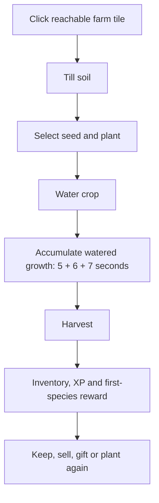
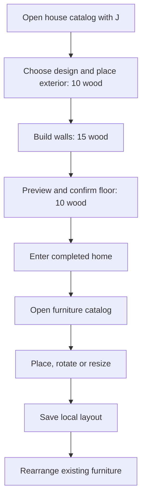
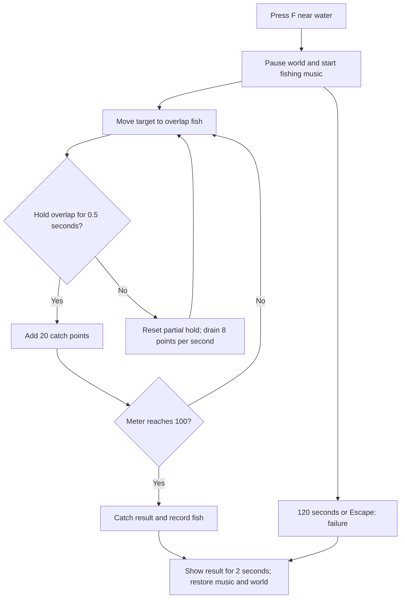
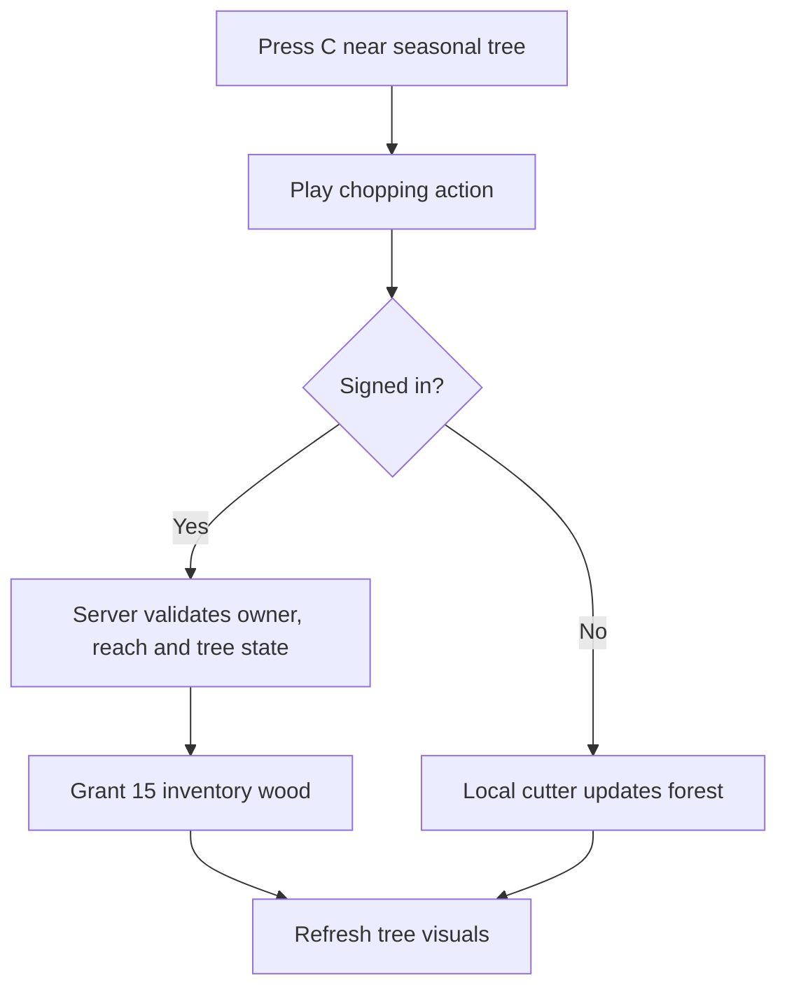
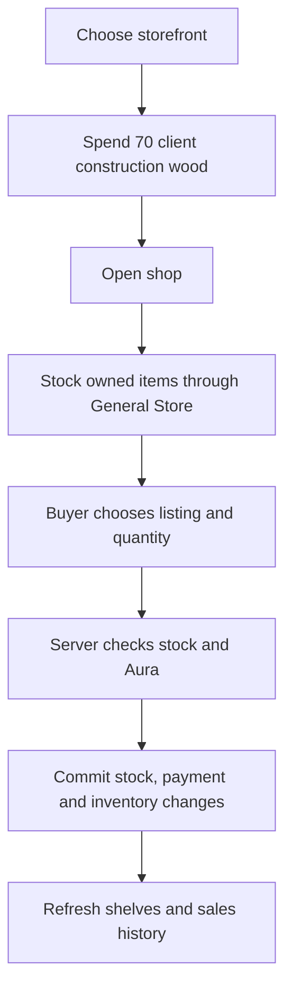
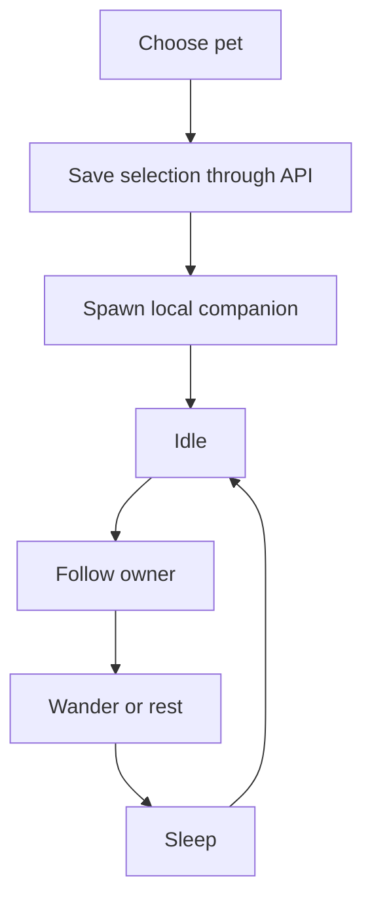
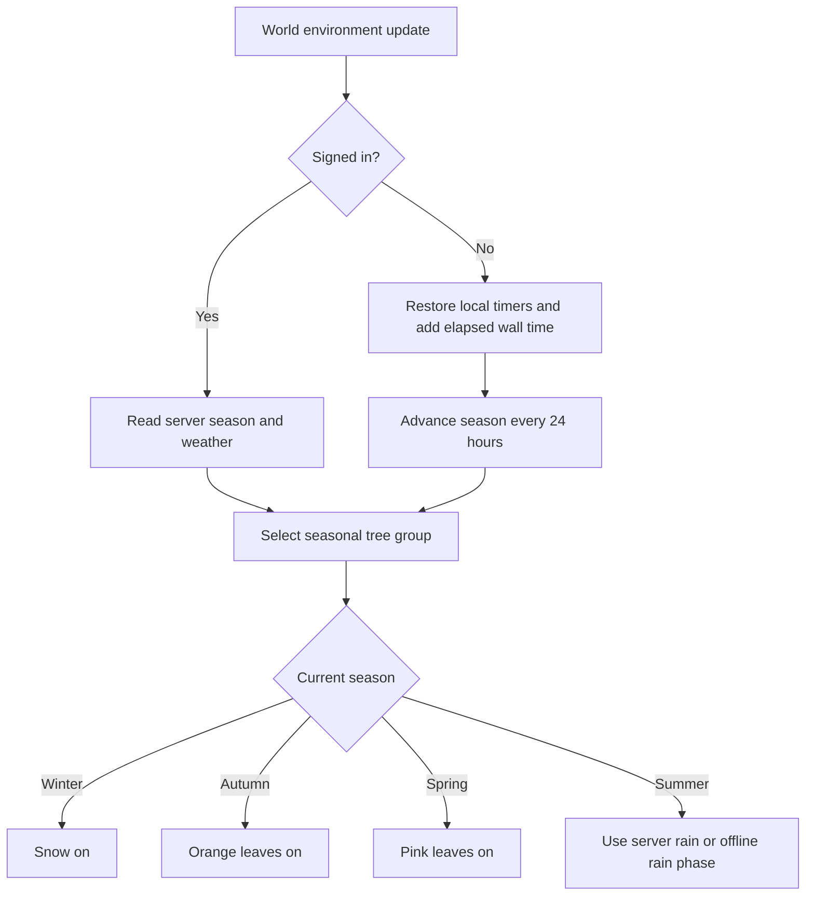
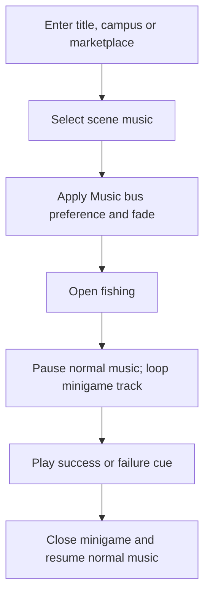
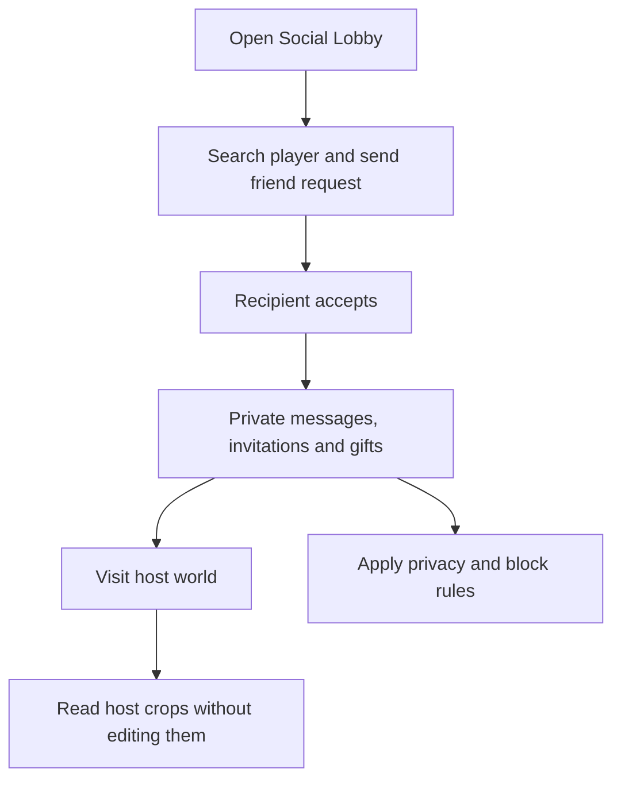

# Game mechanics

Exact constants and important edge cases from the current source.

<strong>Explore this page</strong>

[Home](../README.md) · [Farming](#farming) · [XP and capacity](#xp-and-capacity) · [Store and time](#store-and-time) · [Housing and furniture](#housing-and-furniture) · [Fishing minigame](#fishing-minigame) · [Trees and wood](#trees-and-wood) · [Player shops](#player-shops) · [Companions and customization](#companions-and-customization) · [Seasons weather and lighting](#seasons-weather-and-lighting) · [Music and sound effects](#music-and-sound-effects) · [Social rules and backend progression](#social-rules-and-backend-progression) · [Catalog values](#catalog-values)

## Farming

The current `crop_codes()` reads every plantable catalog row into `SCENE_DURATIONS`. All of these use **5 + 6 + 7 = 18 seconds** of real watered growth. One watering keeps that path growing to harvest; dry time contributes nothing. The fallback path for a crop outside that map uses catalog growth time and seasonal work rates, resetting watering at each stage.

This replaces the old README's potato-specific 22-second claim: that exception is absent from the current server implementation. Catalog growth seconds below describe stored reference data; they do not override the scene-timing branch.

Source: [service.py](../code/server/app/modules/farming/service.py). Coordinates are strict integers from 0 to 32767. A visitor cannot mutate a host's farm. Seed/season/level/soil checks are server-side.

<strong>Farming workflow</strong>

## XP and capacity

| Level | Title | Lifetime XP | Capacity with default base |
| --- | --- | --- | --- |
| 1 | Villager | 0 | 33 |
| 2 | Villager | 80 | 36 |
| 3 | Farmer | 180 | 39 |
| 4 | Farmer | 320 | 42 |
| 5 | Farmer | 500 | 47 |
| 6 | Settler | 750 | 52 |
| 7 | Settler | 1050 | 57 |
| 8 | Settler | 1400 | 62 |
| 9 | Landkeeper | 1800 | 69 |
| 10 | Landkeeper | 2100 | 76 |

Default base capacity is 30. Capacity is `max(base + cumulative level slot increments, occupied stacks)`; existing occupied stacks are never confiscated. For example, level 1 starts at 33 slots; level 2 begins at 80 lifetime XP and has 36 slots.

| Award | XP |
| --- | --- |
| Default planting | 1 |
| Common / seasonal / rare / magical harvest | 5 / 10 / 20 / 30 |
| First harvest of a species, once per player | +15 |
| Eligible sale, per unit | 5 |

Awards depend on the action and item rule; these constants do not mean every item grants sale XP. Level Aura rewards are 25 at level 2 and 100 at level 10. Source: [progression.py](../code/server/app/core/progression.py).

## Store and time

The starter receipt `original_seeds_v1` grants 5 `paddy_seed` and 5 `wheat_seed` once. Common stock is always stocked when buyable; other stock uses `(sum(item_code bytes) + game_day) % 3 == 0`. A purchase total is `buy_value × quantity`. Reusing a request ID with different purchase fields is rejected.

The backend world defaults are **40 minutes per day/night cycle** and **10080 minutes (7 real days) per season**. Existing database values can differ. The client's visual lighting and offline season timers are separate; see [seasons, weather and lighting](#seasons-weather-and-lighting).

Sources: [service.py](../code/server/app/modules/shop/service.py) · [models.py](../code/server/app/modules/world/models.py) · [service.py](../code/server/app/modules/world/service.py).

## Housing and furniture

The playable construction flow is `none → outer → walls → done`. The catalog offers **six exterior/interior designs**, each with **five floor finishes**: Original, Chestnut, Walnut, Honey and Ash.

| Step | Wood cost | Cumulative construction wood |
| --- | --- | --- |
| Place the exterior | 10 | 10 |
| Build the interior walls | 15 | 25 |
| Confirm the floor | 10 | 35 |

House placement snaps to a **32-unit grid**. Furniture placement snaps to **16 units**. Floor selection previews immediately and spends wood only when confirmed. Furniture becomes available after the floor is finished. The manifest currently contains **228 furniture entries across 11 categories**; each entry defines its own wood cost, directional textures, anchor and collision blockers.

R cycles **front → left → back → right**. I/O resizes a carried piece with a size factor clamped to **0.5–2.0** (base furniture scale **1.5**); a resize that hits the walls is rolled back. S enters/exits rearrange mode, where existing furniture can be picked up and placed again. Cancelling an arrangement restores the carried piece rather than buying another one.

Selling a house computes `construction wood spent × 3 Aura`: **30** for an exterior, **75** after walls, **105** after its floor. Furniture does not add to this price. Sell and Destroy both remove the house and contents; Destroy gives no return.

<strong>Current save and resource integration</strong>

The house's design, position, stage, floor and furniture are saved in a local `user://house_<server/account/world key>.json` file. A visitor cannot edit or load an owner layout through this flow. The backend house-tier and decorations APIs are separate implementations; local room layouts are not synchronized through them.

Signed-in construction currently spends from `GameState._test_wood`, initialized to **100** per client session. Offline construction spends local inventory wood. House sale currently calls `change_aura_offline`, including from the signed-in house UI, so the displayed sale credit is not a durable server economy transaction. Server-backed tree wood does not make this temporary construction counter authoritative. These are current integration gaps in otherwise implemented building/decorating systems.

Sources: [house catalog](../code/client/Scripts/housing/house_catalog.gd) · [house manager](../code/client/Scripts/housing/house_manager.gd) · [furniture manifest](../code/client/Assets/furniture/furniture_manifest.json) · [GameState](../code/client/autoloads/GameState.gd).

<strong>Construction workflow</strong>

## Fishing minigame

F near water opens `Scenes/fishing.tscn`. One species is selected at random from **bluegill, carp, catfish, koi, largemouth bass, pufferfish, rainbow trout, salmon, seahorse and sunfish**.

| Rule | Current value |
| --- | --- |
| Time limit | 120 seconds |
| Continuous overlap for one progress step | 0.5 seconds |
| Progress gained per step | 20 points |
| Progress lost while not overlapping | 8 points/second |
| Catch meter bounds | 0–100 |
| Win condition | Meter reaches 100 before timeout |
| Result popup duration | 2 seconds |
| Fish swim speed | Random 80–170 units/second per destination |
| Fish rest at destination | Random 0.2–1.0 seconds |
| Target movement speed | 200 units/second |

Leaving the fish resets the partial 0.5-second hold. Five complete holds, with no intervening drain, fill the meter in **2.5 seconds**. The target is clamped inside the water box. Esc exits without a catch. The local scene tree pauses while the minigame's own processing continues; this does not pause the backend or other players.

`chara_player.gd` receives the completion signal. Offline catches enter local inventory; signed-in catches call `APIClient.record_catch`, with a visible error if the server rejects the result. The `/fishing` backend also contains cast/reel session rules; those are distinct from the moving-target UI's result-recording path.

Sources: [fishing game](../code/client/Scripts/fishing_game.gd) · [fish movement](../code/client/Scripts/fish.gd) · [target](../code/client/Scripts/target.gd) · [character integration](../code/client/Scripts/chara_player.gd) · [fishing service](../code/server/app/modules/fishing/service.py).

<strong>Catch workflow</strong>

## Trees and wood

C chops a nearby tree in the currently visible seasonal tree group. Palm trees remain scenery. The client plays the axe action and chopping effect, then displays floating wood. Signed-in chops call `/trees/chop`; the server validates ownership/proximity/tree state and grants **15 wood per tree** to inventory. The response can include newly spawned trees when a seasonal forest is cleared. Offline tree state and regrowth use the local cutter path.

Tree inventory rewards and the temporary house/shop construction counter are currently separate, as described above.

Sources: [tree cutter](../code/client/Scripts/trees/tree_cutter.gd) · [tree service](../code/server/app/modules/trees/service.py) · [season manager](../code/client/Scripts/TreeSeasonManager.gd).

<strong>Wood workflow</strong>

## Player shops

The marketplace has a General Store and **12 storefront choices**. An owner chooses an empty plot on the left or right; its appearance and position come from `placement.json`. The current client requires and spends **70 construction wood**, refunding it if shop creation fails. The backend creation route stores the shop but does not itself debit that wood; the temporary counter caveat applies here too.

Stocking moves owned items into a shop listing with an owner-selected unit price. Unstocking returns stock. Buying checks listing stock and uses `price × quantity`; the backend handles the buyer/seller inventory and Aura changes in a transaction. Your shop window shows sales; friends' windows show their stocked listings. A player's existing shop is restored from the server rather than rebuilt on each room entry.

Sources: [marketplace client](../code/client/Scripts/marketplace/marketplace.gd) · [General Store](../code/client/Scripts/marketplace/general_store.gd) · [shop window](../code/client/Scripts/marketplace/shop_window.gd) · [market service](../code/server/app/modules/market/service.py).

<strong>Shop workflow</strong>

## Companions and customization

One active companion is selected from **cat, dog, rabbit, fox, duck and red panda**. Its runtime states are idle/relaxing, follow, wander/explore and sleep. Navigation uses the campus geometry and local avoidance; the selected pet is a local companion simulation, while species selection uses GET/PUT `/pets` for signed-in accounts. Offline selection uses `user://pet_companion.cfg`.

The character editor offers **Girl A/B/C and Boy A/B/C**. Wardrobe saves a selected preset; Mirror is read-only. Previews expose eight directions and the idle, walk, hoe, water, fish, scythe and fill-bucket action sheets. They do not implement arbitrary clothing recoloring or a free-form body editor. Display name and device-local About Me use separate profile controls.

Sources: [pet manager](../code/client/Scripts/pets/pet_manager.gd) · [companion behavior](../code/client/Scripts/pets/pet_companion.gd) · [creator panel](../code/client/Scripts/customization/creator_panel.gd) · [character frames](../code/client/Scripts/chara_frames.gd) · [profile panel](../code/client/Scripts/customization_interactions.gd).

<strong>Companion workflow</strong>

## Seasons weather and lighting

There are three independent clocks in this checkout. Online world seasons come from the backend; offline seasons use a saved local timer; the visible day/night tint runs locally. The tint is currently not synchronized to the server clock.

| Clock | Duration | Save and restart behavior |
| --- | --- | --- |
| Online season | Default **10080 minutes / 7 real days** | Backend anchors and persisted world settings; an existing database can override the default |
| Offline season | **86400 seconds / 24 real hours** | `seasonal_state.cfg`; saved every 30 seconds and on exit; elapsed wall time is added on reopening |
| Backend day/night | Default **40 minutes** per full cycle | Backend world settings |
| Visible lighting | **30 minutes**: 25-minute day block + 5-minute night block | Local scene clock; starts at hour 6, which is 7:30 into its cycle; resets when the scene is recreated |

The season order is **Summer → Autumn → Winter → Spring → Summer**.

| Season | What you see | Rain and snow rule |
| --- | --- | --- |
| Summer | Summer tree group | Online: rain only when server weather is `rain`. Offline: the schedule below |
| Autumn | Autumn trees and orange falling leaves | Summer rain stops; autumn leaves emit |
| Winter | Winter trees and falling snow | Snow emits throughout winter, regardless of the server weather label |
| Spring | Spring trees and pink falling leaves | Snow stops; spring leaves emit |

Palm trees stay visible in every season. The effect system switches trees and particles; it does not implement accumulating snow depth or repaint the entire terrain. Rain visuals do not themselves prove a crop has been watered: crop rules are handled by farming state.

### Rain timing

For a fresh offline save, summer begins dry. Rain first starts at **15:00**, lasts **2 minutes**, and repeats every **15 minutes**. That gives a 13-minute dry gap between later showers.

| Elapsed offline weather time | Summer effect |
| --- | --- |
| 00:00–14:59.999 | Dry |
| 15:00–16:59.999 | Rain |
| 17:00–29:59.999 | Dry |
| 30:00–31:59.999 | Rain |
| 45:00–46:59.999 | Next shower |

The rain timer continues across seasons and is saved with the season timer. Returning to summer uses that existing phase rather than restarting a fresh 15-minute wait. Offline catch-up can skip several seasons. Online clients do not run this local weather schedule.

### Visible day and night

These offsets are measured from the lighting cycle's zero point, not from opening the game.

| Cycle offset | Lighting |
| --- | --- |
| 00:00–23:59.999 | Full daylight |
| 24:00–24:59.999 | Smooth sunset, white to blue-violet |
| 25:00–28:59.999 | Full night tint, RGB approximately 0.229 / 0.230 / 0.408 |
| 29:00–29:59.999 | Smooth sunrise back to white |
| 30:00 | Repeat |

Because the scene starts at offset **07:30**, the first sunset begins after **16:30 of uninterrupted scene processing**, and full night starts after **17:30**. Pausing the world for fishing pauses its local lighting processing; server time continues independently.

### Particle timing

| Effect | Particle count | Lifetime of one particle | Initial warm-up |
| --- | --- | --- | --- |
| Rain | 8000 | 0.5 seconds | 0.5 seconds |
| Snow | 4500 | 10 seconds | 30 seconds |
| Autumn leaves | 700 | 1.5 seconds | 0.5 seconds |
| Spring leaves | 700 | 1.5 seconds | 0.5 seconds |

Particle lifetime describes one particle before replacement, not how long the weather lasts. Snow's 30-second preprocess warms the emitter; it is not a 30-second wait before winter starts.

Sources: [world model defaults](../code/server/app/modules/world/models.py) · [seasonal effects](../code/client/Scripts/seasonal_effects.gd) · [day/night tint](../code/client/Scripts/day_night_cycle.gd) · [world scene](../code/client/Scenes/world.tscn).

## Music and sound effects

`AudioManager` creates separate **Music** and **SFX** buses. Both sliders default to **80/100**, and preferences/mute are stored in `user://settings.cfg`. The music transition constant is **0.6 seconds**. World music is trimmed by **−8 dB** relative to the music slider.

| Context | Audio in the current game |
| --- | --- |
| Title | `Wanderville/Landing_page.mp3` |
| Campus, Social Lobby, Customization Lobby | `Wanderville/Wanderville_Background.mp3` |
| Marketplace | `Marketplace/Fair_2.mp3` |
| Fishing | `Minigame/Minigame_2.mp3`; temporarily pauses normal music, with Success/Failure effects and restoration on exit |
| Farming and movement | Walking, tilling, planting, watering, harvesting, collecting water and cutting wood |
| Home and companions | Furniture-placement effect, cat meow and dog woof |
| UI and rewards | Automatic button click/hover, sent/received messages, notifications, Aura, level-up and exit cues |

The SFX pool allows **12 overlapping one-shots**. Long source clips are capped for short actions: tilling, watering and collecting water at **1 second**, chopping at **3 seconds**. This describes the game's audio behavior; the supplied files are linked through the manager rather than duplicated in documentation.

Source: [AudioManager.gd](../code/client/autoloads/AudioManager.gd).

<strong>Music workflow</strong>

## Social rules and backend progression

Friends, requests, private messages, block/privacy settings, gifts, wishlists, invitations and notices have client interfaces and backend services. Farm visitors receive the host world's crops in read-only mode. Nearby text/voice use room membership and proximity checks; they are separate from private messages. Gift recovery and Store recovery use their own saved operation identifiers rather than inventing a second outcome after a timeout.

The backend also exposes goals, statistics, login streak state, trades and event claims. They are part of the implemented service surface; this audit does not identify a dedicated current client screen for every one. See [API](API.md), [progression service](../code/server/app/modules/progression/service.py), [events](../code/server/app/modules/events/service.py) and [social service](../code/server/app/modules/social/service.py).

<strong>Social workflow</strong>

## Catalog values

<strong>Expand the current catalog</strong>

| Code | Buy | Sell | Max stack | Catalog growth seconds |
| --- | --- | --- | --- | --- |
| `paddy` | — | 10 | — | 30 |
| `wheat` | — | 12 | — | 45 |
| `sugarcane` | — | 15 | — | 50 |
| `barley` | — | 12 | — | 60 |
| `oats` | — | 12 | — | 35 |
| `sweet_corn` | — | 25 | — | 180 |
| `zucchini` | — | 15 | — | 150 |
| `bell_pepper` | — | 22 | — | 210 |
| `strawberry` | — | 28 | — | 240 |
| `green_bean` | — | 18 | — | 120 |
| `pumpkin` | — | 30 | — | 200 |
| `brussels_sprouts` | — | 26 | — | 260 |
| `kale` | — | 17 | — | 170 |
| `apple` | — | 35 | — | 300 |
| `turnip` | — | 15 | — | 140 |
| `potato` | — | 20 | — | 220 |
| `carrot` | — | 16 | — | 160 |
| `cabbage` | — | 18 | — | 190 |
| `spinach` | — | 12 | — | 110 |
| `onion` | — | 23 | — | 230 |
| `lettuce` | — | 14 | — | 100 |
| `pea` | — | 16 | — | 130 |
| `radish` | — | 12 | — | 90 |
| `asparagus` | — | 28 | — | 280 |
| `beetroot` | — | 18 | — | 180 |
| `moonflower` | — | 100 | — | 600 |
| `rivermint` | — | 80 | — | 480 |
| `sunbloom` | — | 90 | — | 540 |
| `ancient_grain` | — | 120 | — | 720 |

Generated directly from [catalog.json](../code/server/app/db/catalog.json). Unlock rules also depend on [progression.py](../code/server/app/core/progression.py) and seeded item rules.

<strong>Source and verification</strong>

Source reviewed: `31ca97c39c05` · 2026-11-01. Source inspection is not a new gameplay test.

[← Previous](GAME_DESIGN.md) · [Back to top](#game-mechanics) · [Next →](WORLD_ART_BIBLE.md)
