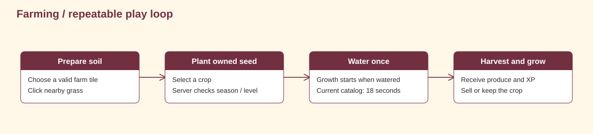

# Start playing

A player guide to exploring, farming, fishing, building a home, shopping, companions, friends and sound.

<strong>Explore this page</strong>

[Home](../README.md) · [First session](#first-session) · [Controls](#controls) · [Campus destinations](#campus-destinations) · [Farming and inventory](#farming-and-inventory) · [Build and decorate a home](#build-and-decorate-a-home) · [Fishing minigame](#fishing-minigame) · [Shops and the marketplace](#shops-and-the-marketplace) · [Companions and appearance](#companions-and-appearance) · [Friends and farm visits](#friends-and-farm-visits) · [Music settings and atmosphere](#music-settings-and-atmosphere) · [When something fails](#when-something-fails)

## First session

1. Start the local server and game using [setup](BUILD_AND_DEPLOY.md), or use an exported game configured for your server.
2. Choose **Begin Adventure**, create an account or sign in, and complete character selection.
3. Enter the campus and follow the welcome and nearby interaction prompts. Explore the farm, water, building site and activity buildings.
4. For a first crop, open the Store through the seed picker and claim the starter pack once: **5 Paddy Seeds + 5 Wheat Seeds**. Click nearby grass in the farm to till it, then click the soil to select a seed.
5. Try the other activities below: catch a fish, choose a pet, visit the Wardrobe, build a house, or meet friends in the Social Lobby. Farming is one route through the game.

No release download or trailer URL is published here because none was verified for this revision.

## Controls

| Key or control | Action |
| --- | --- |
| Arrow keys / WASD | Move; WASD is added by character_spawner.gd |
| Left click in the farm | Till grass, choose a seed, water a dry crop or harvest a ready crop |
| E while pointing at a farm tile | Pick up or drop a soil/crop tile |
| Q | Collect water near water |
| K | Legacy crop-relocation binding; the current farm controller uses E to carry/drop |
| H | Door interaction |
| J | House menu |
| F near water | Fishing (runtime binding in chara_player.gd) |
| F / R / S in housing | Furniture / rotate / rearrange |
| I / O while placing furniture | Increase / decrease its size |
| Left / right click while placing | Place / cancel |
| C | Cut trees |
| Social Lobby | Friends and private messages |
| Pet button in the HUD | Choose your active companion |
| Nearby / Voice | Proximity communication |
| Settings → Leave World | Return to title while keeping the session |

Bindings come from [project.godot](../code/client/project.godot); individual actions also depend on location and interaction state. The selected character adds F for fishing at runtime in [chara_player.gd](../code/client/Scripts/chara_player.gd); [character_spawner.gd](../code/client/Scripts/character_spawner.gd) adds WASD. F and S also have housing actions, so interaction context matters.

## Campus destinations

| Place | What to do |
| --- | --- |
| Farm | Walk inside the farm zone and work nearby tiles with the mouse |
| Pond or canal | Stand near water; Q collects water and F starts fishing |
| Seasonal trees | Move close to a trunk and press C to chop |
| Building site | Press J to choose and place a house |
| CDS building / long five-arch hall | Click the building to open the storage and inventory room; click a shelf to browse its items |
| Auditorium / left three-arch hall | Click to enter the Social Lobby |
| Library / right four-arch hall | Click to enter Character Customization |
| Administration building / main hall | Click the building to enter the separate marketplace street |

Building clicks and proximity prompts are separate interactions. Walk up when a room or shop asks you to come closer.

## Farming and inventory

[Edit the diagram in draw.io](assets/diagrams/farm-loop.drawio).

The seed picker lists owned seeds. Level and season checks happen on the server. Cancelling the picker does not plant. Dry crops do not progress; current catalog crops finish after 18 seconds of watered growth. Inventory categories share one slot pool. Fill partial stacks before expecting a new slot to be available.

Click a watered crop before it is ready to see its growing status. To move a tile, point at it and press E, point at a valid destination within reach, then press E again. Movement and interaction locks prevent working the farm through an open menu.

## Build and decorate a home

1. At the building site, press **J** and choose one of **six house designs**.
2. Move the house preview with the mouse. A green preview marks a valid placement; left click to build or right click to cancel. The exterior costs **10 wood**.
3. Walk to the front door and press **H**. Building the inside costs **15 wood**.
4. Inside, preview a floor: **Original, Chestnut, Walnut, Honey or Ash**. Confirm the selected floor for **10 wood**; **Later** closes the preview without finishing it.
5. Once the floor is finished, press **F** to browse furniture. The catalog has **228 entries across 11 categories**, including seating, tables and storage, bedroom, kitchen, bathroom, lights, decor, tabletop, devices and gym equipment.
6. Place a piece with the mouse. **R** rotates it; **I/O** makes it larger/smaller; left click confirms; right click cancels. Furniture has its own wood cost and must fit on the floor without hitting walls.
7. Press **S** inside to rearrange, click a piece to pick it up, and press S when done. Walk to the stairs/exit to return outside.

Press J outside an existing house for its Sell/Destroy options. Both remove the house and its contents; read the confirmation before choosing. House layouts are saved on this device and scoped to the server, account and owned world. The current client wood and house-sale handling is described in [mechanics](GAME_MECHANICS.md#housing-and-furniture).

## Fishing minigame

1. Stand next to a lake or other valid water edge and press **F**.
2. Move the target with the direction controls and keep it overlapping the swimming fish.
3. Each **0.5 seconds** of uninterrupted overlap adds **20** to the catch meter. Slipping off resets that half-second hold and drains the meter.
4. Fill the meter to **100** before the **two-minute** timer runs out. **Esc** gives up.
5. A successful catch shows the species and adds it to inventory after the catch is recorded. If the backend cannot keep the catch, the game shows an error.

The ten possible fish are **bluegill, carp, catfish, koi, largemouth bass, pufferfish, rainbow trout, salmon, seahorse and sunfish**. The minigame has its own music, success and failure cues. It pauses the local world and restores the previous music and controls when it closes.

## Shops and the marketplace

The CDS storage room has clickable crop crates, a seed shelf, a fish tank and miscellaneous crates. Its aquarium displays up to **five owned fish swimming**. Click a section to inspect item slots, descriptions, prices and buy/sell quantities. Esc goes from section → room → closed. The seed picker also links to the Store. Quantity and price are shown before a transaction; interrupted Store purchases use saved receipts for recovery.

The separate **marketplace** is a side-scrolling street with a General Store, empty plots and player-owned shops. Walk close before clicking a plot or shop. To open your shop, choose a side/plot and one of **12 storefront designs**; the client currently charges **70 wood**. Use the General Store's **Stock my shop** tab to put owned items on your shelf with a price. Your shop window shows its listings and sales; friends' shop windows let you buy their stocked items. Use **Leave [E]** to return.

The player marketplace and the general buy/sell Store are different interfaces. Details of their current wood and transaction handling are in [mechanics](GAME_MECHANICS.md#player-shops).

## Companions and appearance

Use the **pet button** in the HUD to choose **Cat, Dog, Rabbit, Fox, Duck or Red Panda**. One companion is active at a time. It follows, wanders, rests and sleeps; signed-in species selection is saved to your account.

Character Customization has **six presets**: Girl A/B/C and Boy A/B/C. The **Wardrobe** changes the equipped preset. Turn the preview, choose an action and pause/play its animation before saving. The **Mirror** previews the current character without changing the selection. The room also has profile controls; **P** opens the profile there. Display-name changes and the locally stored About Me text are separate fields.

## Friends and farm visits

Open Social for private messages, friends, incoming requests, blocked players, invitations and notices. In the Social Lobby, Reception helps you find a friend; its stations open friend requests, invitations and notifications. Nearby text and Voice are tied to proximity and room membership. Gifts, wishlists and privacy have their own community panel.

Invite a friend to your farm or accept an invitation from the farm-visit interface. Visitors see the host's crops in read-only mode; planting, harvesting, tree cutting and local house editing are protected by the current ownership/session checks. Return to your own farm before sending invitations as a host.

## Music settings and atmosphere

**Settings** has separate **Music** and **SFX** sliders, a music **Mute** control, Remember Device, profile/logout controls and **Leave World**. Audio preferences are saved locally. Leave World returns to the title while keeping the account signed in; Logout ends the session.

The title, campus and marketplace use different background tracks. Fishing temporarily plays its own loop. Footsteps, tilling, planting, watering, harvesting, collecting water, chopping, furniture placement, pet sounds, button hover/click, messages, notifications, Aura and level-ups have sound cues.

The world also includes day/night tint, rain, snow, seasonal leaves and changing tree groups. Signed-in seasonal weather comes from backend state; the local lighting cycle and offline season schedule have their own timings, documented in [mechanics](GAME_MECHANICS.md#seasons-weather-and-lighting).

## When something fails

| Symptom | What to do |
| --- | --- |
| Cannot reach the server | Check the configured API address and `/ready`; the local game launcher expects port 8000 |
| Purchase outcome is unclear | Reopen the Store and let it check the retained transaction receipt before retrying |
| Seed cannot be planted | Check ownership, level, season and target tile |
| Farm is read only | Leave the visit and return to your own world |
| Movement changes in experimental ENet mode | Farm/house transitions fall back to the WebSocket path |

For a bug report, include the action, expected result, screenshot and client/server revision. Remove tokens and account details from logs.

<strong>Source and verification</strong>

Source reviewed: `31ca97c39c05` · 2026-11-01. Source inspection is not a new gameplay test.

[Home](../README.md) · [Back to top](#start-playing) · [Next →](GAME_DESIGN.md)

## Weather and time

Winter brings falling snow and winter trees; autumn has orange leaves, spring pink leaves, and summer can bring rain. Palms remain visible all year. Online seasons default to seven real days each; offline seasons last 24 hours and catch up while the game is closed. Fresh offline summer first rains after 15 minutes, for two minutes, then repeats every 15 minutes.

Visible lighting runs through a 30-minute local cycle including sunset and sunrise. Its timer is separate from the server's default 40-minute clock. See [exact phase timings](GAME_MECHANICS.md#seasons-weather-and-lighting), and the [animation gallery](WORLD_ART_BIBLE.md#animation-gallery) for characters, companions, crop stages and house doors.
