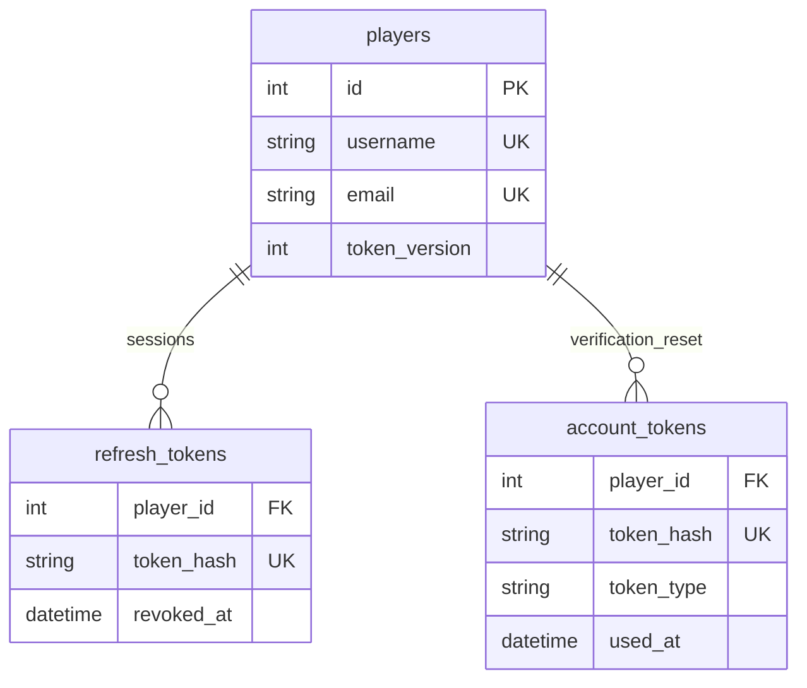
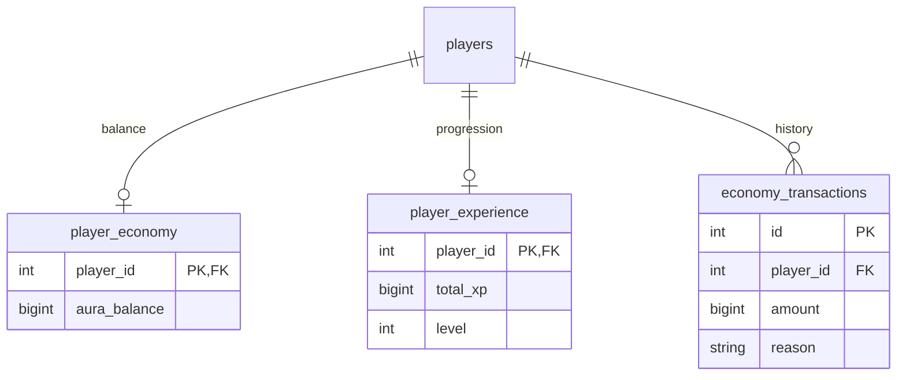
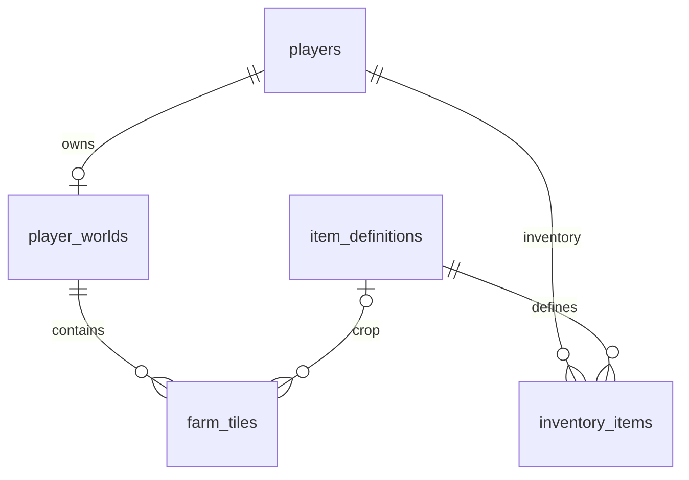

# Core database relationships

All player-owned foreign keys cascade on deletion. Item definitions are reference
data and are not deleted with accounts. `world_state` is an independent singleton.

Signup requires the three one-to-one gameplay records in one transaction; the
database enforces at most one of each per player. Empty farm tiles have a null
crop reference. `(world_id, x, y)` is unique. Inventory stacks are unique by
`(player_id, item_code, location)`.
