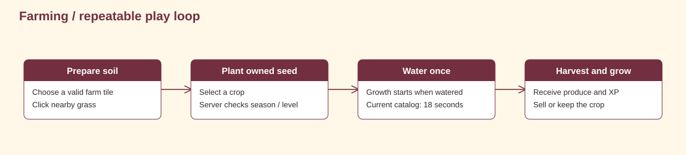

# Game design

Wanderville's farming, home building, fishing, shops, companions, social spaces and sound.

<strong>Explore this page</strong>

[Home](../../README.md) · [The experience](#the-experience) · [What players can do](#what-players-can-do) · [Connected play loops](#connected-play-loops) · [Core loop](#core-loop) · [Design choices in code](#design-choices-in-code) · [Integration boundary](#integration-boundary)

## The experience

Wanderville is a campus life and farming game where growing crops is one part of making a place your own. Players can build and furnish a house, catch fish in a moving-target minigame, run a shop, choose a companion, change their character, and spend time with friends. Red-brick halls, canals, orchards, wooden interiors, animated characters and music connect these activities into the same world.

## What players can do

| System | The experience in the current client | Main implementation |
| --- | --- | --- |
| Campus exploration | Walk around the canals, bridges, farm, orchard and buildings; enter separate activity rooms | [World](../../code/client/Scenes/world.tscn), [map](../../code/client/Scenes/map2.tscn) |
| Farming | Click to till, choose an owned seed, water and harvest; carry and relocate tiles | [Farm controller](../../code/client/Scripts/farm_controller.gd) |
| Tree cutting | Approach a seasonal tree and chop it for wood; cleared forests can regrow | [Tree cutter](../../code/client/Scripts/trees/tree_cutter.gd) |
| Housing | Choose one of six houses, place it, construct its walls and floor, and walk inside | [House manager](../../code/client/Scripts/housing/house_manager.gd) |
| Interior decoration | Preview five floor finishes; browse 228 furniture entries in 11 categories; rotate, resize and rearrange pieces | [Floor picker](../../code/client/Scripts/housing/floor_picker.gd), [furniture catalog](../../code/client/Scripts/furniture/furniture_catalog.gd) |
| Fishing minigame | Follow a moving fish with a target, build the catch meter and land one of ten species | [Fishing game](../../code/client/Scripts/fishing_game.gd) |
| Inventory and General Store | Browse item shelves, inspect stacks, buy supplies and sell produce or fish | [Storage room](../../code/client/Scripts/inventory/storage_menu.gd), [General Store](../../code/client/Scripts/marketplace/general_store.gd) |
| Player marketplace | Walk a shop street, choose a storefront, stock your own shelf, buy from friends and review sales | [Marketplace](../../code/client/Scripts/marketplace/marketplace.gd), [shop window](../../code/client/Scripts/marketplace/shop_window.gd) |
| Pet companions | Choose a cat, dog, rabbit, fox, duck or red panda that follows, explores, rests and sleeps | [Pet manager](../../code/client/Scripts/pets/pet_manager.gd) |
| Character customization | Choose among six presets; revisit the Wardrobe, rotate and animate previews, or inspect the Mirror | [Creator panel](../../code/client/Scripts/customization/creator_panel.gd) |
| Social play | Visit the Social Lobby, search for friends, handle requests, message, invite friends to farms and view notices | [Lobby interactions](../../code/client/Scripts/social/lobby_interactions.gd) |
| Nearby communication | Proximity text and native voice, with privacy, gifts and wishlist interfaces | [Proximity social](../../code/client/Scripts/social/proximity_social.gd), [community window](../../code/client/Scripts/social/community_window.gd) |
| Progression | Earn Aura and XP, unlock catalog items and expand the shared inventory | [Progression rules](../../code/server/app/core/progression.py) |
| Seasons and atmosphere | Seasonal tree groups, rain, snow, drifting leaves and day/night tint | [Seasonal effects](../../code/client/Scripts/seasonal_effects.gd), [lighting](../../code/client/Scripts/day_night_cycle.gd) |
| Music and feedback | Menu, world, marketplace and fishing tracks; footsteps, farm actions, furniture, pet, chat and reward sounds | [AudioManager](../../code/client/autoloads/AudioManager.gd) |

The counts above come from the current house menu, floor catalog, furniture manifest, fishing species list and character editor. They describe source-wired features; runtime verification is recorded separately in [testing](TESTING.md).

## Connected play loops

- **Grow and trade:** seeds → crops → harvest → inventory → Store or player-shop stock → Aura and XP.
- **Build a home:** choose a house → place an exterior → build walls → preview a floor → furnish and rearrange → return to the campus.
- **Take a fishing break:** approach water → start the minigame → follow the fish → land a catch → keep or sell it.
- **Make it personal:** change appearance → choose a companion → decorate an interior → explore with friends.
- **Meet and visit:** enter the Social Lobby → find friends → send or accept a farm invitation → explore the host's farm.

Music changes with the activity. Fishing temporarily replaces the world track with its own loop and restores the world music when it closes. Sound effects mark actions such as planting, placing furniture, catching a fish and leveling up.

## Core loop

Planting spends an owned seed. Watering starts growth. Harvesting produces an inventory item and XP. Selling converts eligible items into Aura; higher levels expand capacity and unlock catalog entries. The precise values are in [mechanics](GAME_MECHANICS.md).

## Design choices in code

| Choice | Player consequence | Evidence |
| --- | --- | --- |
| One shared inventory capacity | Categories cannot bypass slot limits | [Inventory service](../../code/server/app/modules/inventory/service.py) |
| Owner-only farm mutations | Visiting does not let another player consume or move your crops | [World access](../../code/server/app/modules/world/access.py) |
| Durable store receipts | Retrying a purchase can recover the original outcome | [Shop service](../../code/server/app/modules/shop/service.py) |
| Short watered growth | A new farmer can complete a loop in one session | [Farming service](../../code/server/app/modules/farming/service.py) |

These are observations about the implementation. They are not attributed quotes from the creators.

## Integration boundary

Farming, fishing catches, inventory, shops, profiles, companion selection and social actions have client calls into backend modules. The playable house construction and furniture arrangement flow keeps detailed layouts on this device; it is separate from the backend's house-tier/decorations API. Its current wood spending also uses a temporary client resource path. These boundaries are detailed in [mechanics](GAME_MECHANICS.md) and [client implementation](CLIENT_SIDE.md).

Goals, statistics, login streaks, trades and event claims also exist in backend services. Their presence is recorded in [API](API.md); a separate full gameplay screen is not assumed for every endpoint. ENet campus movement remains an optional transport mode, rather than the definition of the game's multiplayer or social experience.

<strong>Source and verification</strong>

Source reviewed: `31ca97c39c05` · 2026-11-01. Source inspection is not a new gameplay test.

[← Previous](MANUAL.md) · [Back to top](#game-design) · [Next →](GAME_MECHANICS.md)
