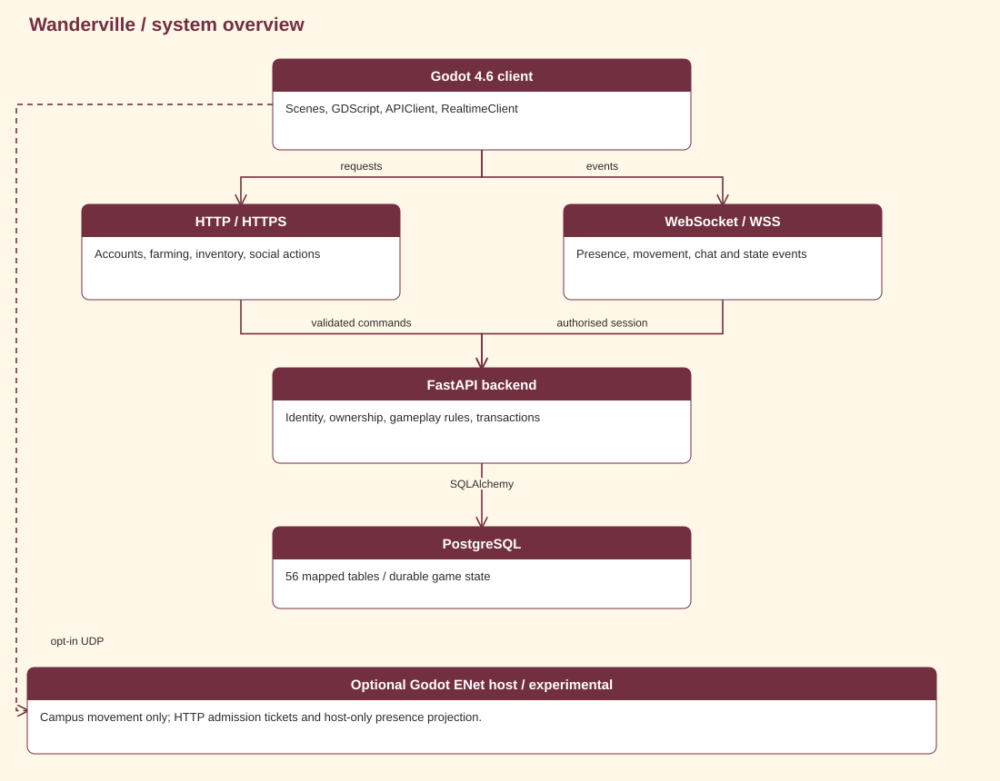

# Networking

Default WebSocket play, optional ENet movement, and world authority.

<details>
<summary><strong>Explore this page</strong></summary>

[Home](../../README.md) · [Transport responsibilities](#transport-responsibilities) · [Admission and movement](#admission-and-movement) · [Rooms and permissions](#rooms-and-permissions) · [Local activities and synchronization](#local-activities-and-synchronization) · [Limits and reproduction](#limits-and-reproduction)

</details>


## Transport responsibilities



| Transport | Responsibility | Scope |
| --- | --- | --- |
| HTTP / HTTPS | Accounts and durable gameplay mutations | API services |
| WebSocket / WSS | Default realtime movement, room state, chat/events | Normal game path |
| ENet / UDP | Authoritative campus movement and prediction | Opt-in experiment |
| Host-only HTTP | Consume admission tickets and project host positions | Dedicated host → backend |

Do not present the dedicated server as required for ordinary play. `GODOT_ENET_GAMEPLAY` must be enabled on the client and dedicated host, with `GODOT_MOVEMENT_ENABLED` on the host. The client requests admission using its logged-in session; production gameplay does not need `TEST_TOKEN`.

## Admission and movement

The bridge attaches to the existing player body. The dedicated host consumes a backend-issued admission ticket, checks campus compatibility and selects spawn. The client predicts locally, accepts authoritative correction and interpolates remote avatars. The host publishes authoritative positions to `POST /internal/multiplayer/presence` at 5 Hz. This projection is in-memory, not durable player-position storage.

The bridge suppresses duplicate WebSocket movement and avatar rendering while it owns campus motion. Failed admission, incompatible geometry, timeout or leaving supported scope restores the ordinary body/controller/collision and remote renderer.

## Rooms and permissions

`campus` is shared; `world:{id}` identifies a persistent personal world. Farm reads resolve the current session world. Farm writes require ownership. A visitor receives host-world crop state in read-only mode, never the visitor's own crops relabeled as host data. Presence/room epochs prevent stale projections from crossing room changes.

Farm and house room simulation are outside the experimental ENet host's scope. Switching rooms hands movement back to the standard path. This boundary is relevant when investigating house-entry correction or rubber-banding; this review does not establish that a new house-entry bug is reproduced.

## Local activities and synchronization

HouseManager places a selected interior far from the campus in the local scene. During its entry fade it sets `APIClient.realtime.pause_movement = true`, moves the player to the interior spawn and switches camera bounds. Leaving returns to the exterior door, restores campus camera bounds and resumes movement publication. This prevents an interior coordinate from being sent as an ordinary campus move. It does not make furniture arrangements a shared server room or a synchronized layout.

Fishing pauses the local Godot scene tree while the minigame and audio continue. Other clients and backend time keep running. Completion submits a catch result for signed-in players. Reconnect, presence timeout and pause duration therefore need testing together; a local pause is not a server-wide pause.

Companion movement and sleep states are local simulations; the pet API persists selection. Wardrobe saves appearance through account/profile integration. Marketplace listings, stock, purchases and sales use HTTP services. Music, effect playback, local house furniture and device preferences are not replicated as live movement events.

Sources: [house transitions](../../code/client/Scripts/housing/house_manager.gd) · [fishing entry/results](../../code/client/Scripts/chara_player.gd) · [fishing UI](../../code/client/Scripts/fishing_game.gd) · [companion selection](../../code/client/Scripts/pets/pet_manager.gd) · [marketplace](../../code/client/Scripts/marketplace/marketplace.gd).

## Limits and reproduction

ENet UDP is plaintext and the dedicated host defaults to loopback. The experiment is intended for local/trusted networks. Campus collision uses harvested static geometry rather than all TileSet collisions; runtime collision changes are confined to the opt-in path. Reconnect uses a server-selected spawn, not a durable ENet position. Memory presence requires the documented single-worker deployment.

```powershell
.\code\server\.venv312\Scripts\python.exe code/server/scripts/verify_enet_gameplay.py
```

The verifier requires Godot and PostgreSQL binaries; configure `GODOT_EXE` and `PG_BIN`. It creates disposable test services and databases. Historical outcomes are in [testing](TESTING.md), not claimed as a run of this documentation revision.

Sources: [EnetGameplayBridge](../../code/client/Scripts/network/EnetGameplayBridge.gd) · [MovementClient](../../code/client/Scripts/network/MovementClient.gd) · [MovementAuthority](../../code/client/Scripts/network/MovementAuthority.gd) · [admission router](../../code/server/app/modules/realtime/admission_router.py) · [internal router](../../code/server/app/modules/realtime/internal_router.py) · [configuration](../../code/server/app/core/config.py).

<details>
<summary><strong>Source and verification</strong></summary>

Source reviewed: `31ca97c39c05` · 2026-11-01. Source inspection is not a new gameplay test.

</details>

[← Previous](API.md) · [Back to top](#networking) · [Next →](TESTING.md)
