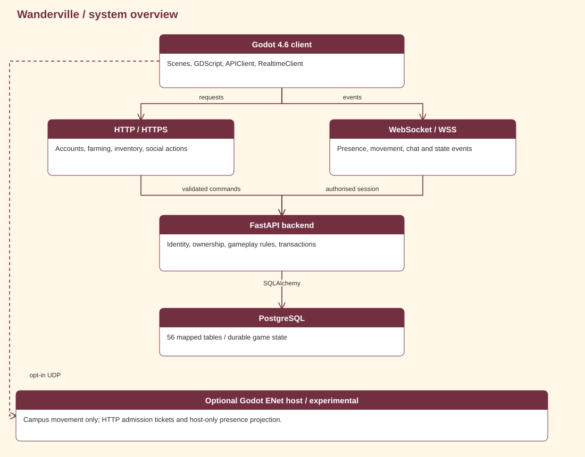
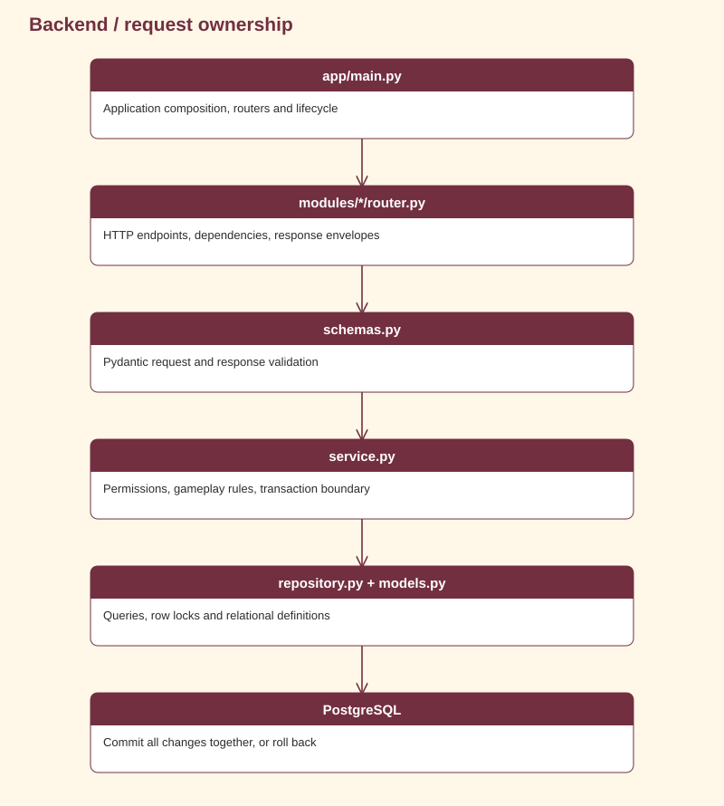
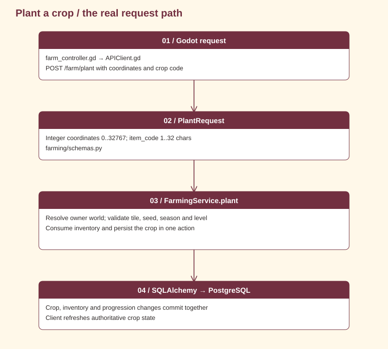
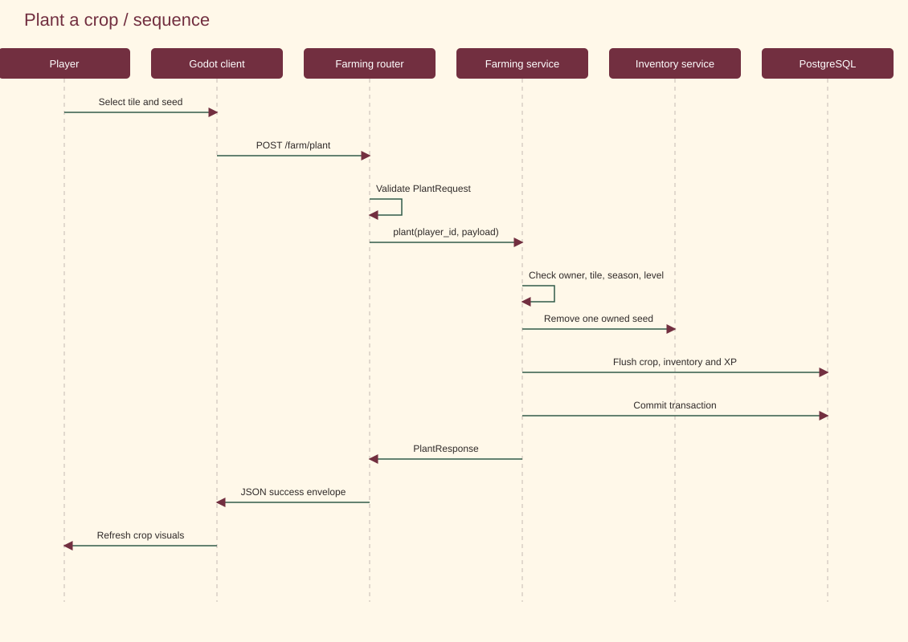

# System design

Where requests go, who owns the rules, and what is saved.

<strong>Explore this page</strong>

[Home](../../README.md) · [System overview](#system-overview) · [Gameplay ownership](#gameplay-ownership) · [Backend layers](#backend-layers) · [Planting across the layers](#planting-across-the-layers) · [Integrity and limits](#integrity-and-limits)

## System overview

[Edit in draw.io](../assets/diagrams/system.drawio). HTTP and WebSocket are separate transports into the same backend. PostgreSQL holds durable accounts and game state. The optional ENet host simulates campus movement; it does not replace gameplay services.

## Gameplay ownership

The game also includes six house interiors, construction and furniture editing, a fishing minigame, a separate player marketplace, companions, customization, social rooms and an audio system. A client → database diagram alone does not describe all of those systems.

| System | Client responsibility | Durable state or current boundary |
| --- | --- | --- |
| Farming and trees | Grid/reach interaction, crop visuals, axe action and effects | API services validate ownership and inventory rewards; PostgreSQL stores crop/tree state |
| House construction | Choose/place one of six houses, build stages, preview floors, enter/exit | Detailed layout is device-local and account/world scoped; temporary construction wood is client-managed |
| Furniture | Manifest catalog, directional sprites, blockers, placement, rotation, scale and rearrangement | Saved with the local house layout; separate from backend decoration rows |
| Fishing minigame | Fish/target motion, overlap meter, local pause and result cues | Signed-in completion calls the catch-recording API; backend cast/reel sessions are a separate contract |
| Inventory room | Shelves, slots, aquarium, quantity/details UI | Server stacks and Store receipts for signed-in operations |
| Marketplace | Side-scrolling street, plots, storefront choice, stock and sales interfaces | PlayerShop/ShopListing/ShopSale and transactional backend stock/purchases; creation wood is currently client-managed |
| Companions | Navigation, following, wandering and sleeping | Selected species saved through the pet API; behavior runs locally |
| Appearance/profile | Six-preset editor, Wardrobe, Mirror and animation preview | Selected character/display name use account calls; About Me is device-local |
| Social | Lobby stations, people/cards, chat, invitations, gifts and privacy UI | Backend friendship, room/visit, messaging, gift and policy state |
| Music and atmosphere | Scene tracks, SFX, volume buses, day/night tint and particles | Audio preferences are local; online season/weather comes from world state; lighting has its own clock |

See [client implementation](CLIENT_SIDE.md) for the owning scripts and [mechanics](GAME_MECHANICS.md) for the exact construction, fishing and audio rules.

## Backend layers

[Editable source](../assets/diagrams/backend.drawio). `app/main.py` composes routers, middleware, errors and an optional background worker. Routers inject authenticated identity and a database session. Services enforce policy. Repositories and ORM models access state. Validation occurs before service execution, with response validation after the handler where a response model is declared.

## Planting across the layers

Editable: [workflow](../assets/diagrams/planting.drawio) · [sequence](../assets/diagrams/planting-sequence.drawio). InventoryService participates inside the farming action's transaction; it does not commit a separate purchase or seed removal.

## Integrity and limits

The outer `transaction(db)` commits or rolls back one service action. Nested transaction boundaries raise an error. Identity comes from server authentication; showing a disabled client button is not authorization. Player locks serialize conflicting player actions where explicitly taken by the service.

In-memory presence and realtime runtime are per-process. The deployment blueprint uses one worker. A multi-worker/shared-presence design is future work. [app/main.py](../../code/server/app/main.py) currently includes `shop_router` twice, duplicating six method/path registrations.

Sources: [main.py](../../code/server/app/main.py) · [transaction boundary](../../code/server/app/db/session.py) · [owner checks](../../code/server/app/modules/world/access.py) · [farming service](../../code/server/app/modules/farming/service.py).

<strong>Source and verification</strong>

Source reviewed: `31ca97c39c05` · 2026-11-01. Source inspection is not a new gameplay test.

[← Previous](WORLD_ART_BIBLE.md) · [Back to top](#system-design) · [Next →](CLIENT_SIDE.md)
