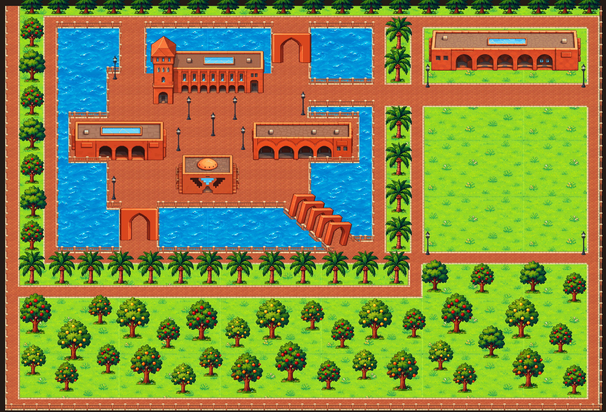
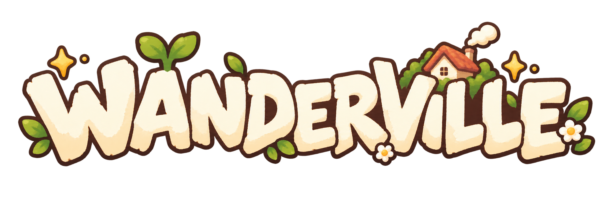
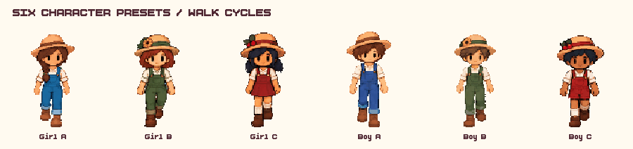
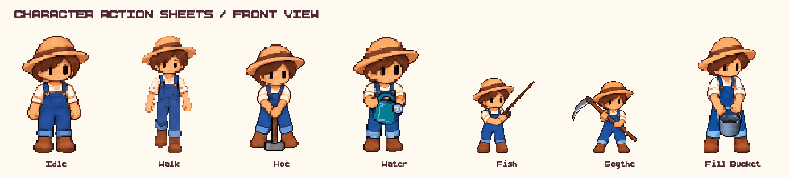
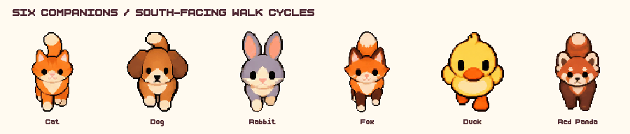
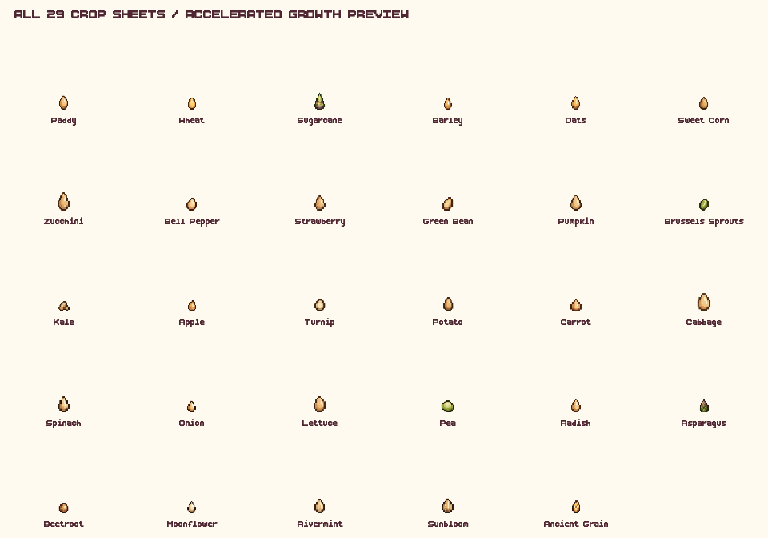
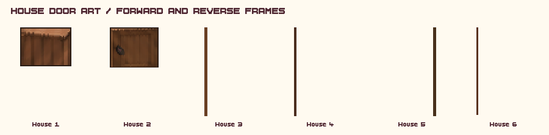

# World and art

A practical reference for matching the existing world and keeping promotional art separate.

<strong>Explore this page</strong>

[Home](../../README.md) · [Existing visual identity](#existing-visual-identity) · [Logo and characters](#logo-and-characters) · [Homes interiors and activity spaces](#homes-interiors-and-activity-spaces) · [Music and sound identity](#music-and-sound-identity) · [Banner and animation](#banner-and-animation) · [Extending the art](#extending-the-art)

## Existing visual identity

This is a Godot capture of the actual Map scene referenced by `world.tscn`: red brick arches, canals, palms, orchard trees and warm paths. It is a fixed daylight scene preview, without a signed-in session or HUD. The original [title background](../../code/client/Assets/background/bg.webp) remains in the game assets.

| Color | Documentation use |
| --- | --- |
| Maroon `#722f40` | Diagram headers and primary lines |
| Forest `#315c49` | Secondary workflow accents |
| Oak `#aa754c` | Warm structural accents |
| Cream `#fff8e9` | Diagram canvas |
| Ink `#302b2a` | Body labels |

This palette is a documentation design choice inspired by the game; it is not claimed as an existing engine-wide palette constant.

## Logo and characters

The unchanged logo source is [Wanderville_Logo.png](../../code/client/Assets/background/Wanderville_Logo.png). The farmer comes from [world character animation sheets](../../code/client/Assets/charas/complete_animations/blue_male). Preserve sprite proportions and transparent edges. Resize small pixel sprites with nearest-neighbor sampling. Match existing animation sheets instead of guessing a universal sprite grid.

## Homes interiors and activity spaces

The world includes **six house designs**, each with an exterior, interior walls/doors, five selectable floor finishes and a furniture layout. The floor names are Original, Chestnut, Walnut, Honey and Ash. House scenes live at [house1.tscn](../../code/client/Scenes/house1.tscn) through [house6.tscn](../../code/client/Scenes/house6.tscn); artwork is grouped under [Assets/house](../../code/client/Assets/house).

The [furniture manifest](../../code/client/Assets/furniture/furniture_manifest.json) defines **228 entries** in seating, tables/storage, bedroom, kitchen, bathroom, lights, decor, tabletop, devices, gym and small gym-item categories. Preserve each item's front/left/back/right images, anchor and blockers when adding a piece; these control placement and collision as well as its appearance.

The [inventory room](../../code/client/Assets/inventory) presents crop crates, a seed shelf, miscellaneous crates and an aquarium that animates up to five owned fish. The [marketplace](../../code/client/Scenes/marketplace.tscn) uses its own street backdrop, General Store and twelve storefront variants. Social Lobby and Customization Lobby are separate furnished rooms, with Reception/stations and Wardrobe/Mirror interactions respectively.

Character presets use fixed **448 × 448** animation cells, eight directions and action sheets for idle, walk, hoe, water, fish, scythe and fill-bucket. The [complete animation sets](../../code/client/Assets/charas/complete_animations) contain the six selectable characters. Companions have their own [pet art](../../code/client/Assets/Pets), directional movement and sleep imagery. Fish have species-specific animations for the minigame and aquarium. Keep the existing effective on-screen scale; a source cell dimension is not the character's displayed size.

## Music and sound identity

The audio is part of the game's presentation: the landing-page theme welcomes the player, the campus/world track carries exploration and the social/customization rooms, the marketplace has a fair theme, and fishing uses its own loop with result cues. Footsteps and action effects make movement, farming, wood cutting and furniture placement audible; pet calls, chat, notifications, Aura and level-ups add feedback.

[AudioManager.gd](../../code/client/autoloads/AudioManager.gd) is the sound catalog and scene-to-music map. Source tracks/effects live under [Assets/sounds](../../code/client/Assets/sounds). Keep Music and SFX separate so settings can mix them independently. Match existing per-track trims and short action caps before replacing a clip with a much louder or longer file. See [audio mechanics](GAME_MECHANICS.md#music-and-sound-effects).

## Banner and animation

The README uses a **1920 × 240** pixel-art banner generated with the built-in image generator. References were the actual campus map capture, botanical logo, main hall with tower, blue-overall straw-hat farmer and crop sheet. The prompt requested a light, fluffy campus-and-farm panorama with pale cream clouds, aqua canals, the brick hall/bridge, crops, a farmer and duck, and a readable centered logo. The shallow illustrated band was exported without stretching the character or logo. This is generated promotional artwork; the full campus image earlier in this page is an actual Godot scene capture.

The [animation gallery](#animation-gallery) collects the game sprite previews in expandable sections.

## Extending the art

Use the current scene's viewpoint and source sprite dimensions. Check the asset's import and scene settings before changing texture filtering or scale. Keep crop stage silhouettes readable. Reuse existing wood/cream UI textures for game controls. Review both bright terrain and night tint before approving new art.

Authorship and license information are not complete in the repository. Reusing an included asset does not establish a redistribution license. Add confirmed author/license entries when available; no creator attribution has been invented here.

<strong>Source and verification</strong>

Source reviewed: `31ca97c39c05` · 2026-11-01. Source inspection is not a new gameplay test.

[← Previous](GAME_MECHANICS.md) · [Back to top](#world-and-art) · [Next →](SYSTEM_DESIGN.md)

## Animation gallery

These looping previews use the game's actual sprite sheets and door atlas regions. Crop growth is accelerated for illustration. Door previews cycle source frames forward and backward; they are not recordings of an interaction.

| Preview | Source and runtime behavior |
| --- | --- |
| Characters | Six presets; eight directions; idle 6 FPS, other configured actions 8 FPS |
| Farmer actions | Idle, walking, hoeing, watering, fishing, scythe and filling a bucket; gallery uses a common 8 FPS |
| Companions | Six pets, eight directions, walking at 8 FPS; movement is local |
| Crops | 29 crop sheets, five art stages; preview timing does not represent server growth |
| Doors | Atlas frames from all six house scenes; gallery timing is illustrative |

<strong>Characters and farming actions</strong>

<strong>Companions, crops and house doors</strong>

For snow, rain, leaves and lighting durations, see [season effects and timing](GAME_MECHANICS.md#seasons-weather-and-lighting).
